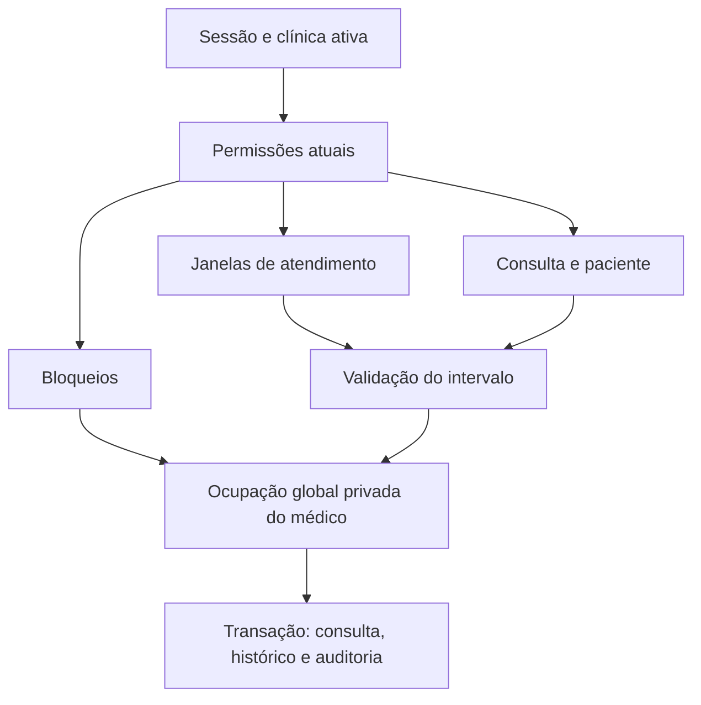

# Agenda interna e consultas

Etapa 019: agenda mantida no IntegraConsultas, com horários semanais de atendimento, bloqueios e consultas. Google Agenda, WhatsApp, autoagendamento e lista de espera continuam em etapas futuras. A integridade implementada nesta etapa cobre os registros internos.

## Acesso

Recepção e administração gerenciam a agenda da clínica selecionada. Médico com função de recepção gerencia somente a própria agenda. Médico sem essa função consulta sua agenda e altera sua duração padrão. Administrador com função de médico também possui a visualização própria; sem essa função, não recebe os atalhos Minha agenda e Meus pacientes. Dev consulta a clínica selecionada, sem executar operações de agendamento.

Permissões são verificadas no banco em cada operação, usando a sessão, a clínica ativa e os vínculos atuais. Identificadores enviados pelo navegador não concedem acesso. Uma consulta de outra clínica não revela dados; conflitos entre clínicas informam apenas que o horário está ocupado.

## Regras

- Agendada e confirmada ocupam o horário. Cancelada, concluída e falta preservam histórico e liberam a ocupação interna.
- Confirmação mantém a vaga. Reagendamento exige horário livre e retorna a consulta a agendada, exigindo nova confirmação.
- Conclusão e falta são registradas após o término da consulta. Consultas encerradas não mudam de estado nesta versão.
- A duração padrão é 15, 30, 45 ou 60 minutos. O médico que agenda na própria agenda pode escolher outra dessas durações. Recepção e administração utilizam o padrão e preservam exceções existentes ao reagendar.
- Novas consultas e reagendamentos começam no futuro, com precisão de minuto, e cabem integralmente em uma janela semanal de atendimento. Esta versão não oferece janelas que atravessam a meia-noite.
- Bloqueios ocupam o horário do médico em todas as clínicas e duram no máximo 31 dias. Sua retirada preserva auditoria. Alterar horários de atendimento não cancela consultas existentes.
- Substituição exige seleção explícita da consulta ativa da mesma clínica e médico. O novo intervalo deve se sobrepor ao intervalo selecionado; a operação cancela a anterior e cria a nova atomicamente. Outros conflitos continuam impedindo o agendamento.
- Desativar o perfil médico não libera consultas existentes. A equipe da clínica pode cancelá-las; novos agendamentos exigem médico ativo.
- Consultas criam vínculo com o paciente e impedem exclusão física de seu cadastro. Arquivamento preserva consultas históricas, mas impede novos agendamentos e reagendamentos para esse paciente.

## Horários e concorrência

O navegador envia a data e a hora locais; o banco converte pelo fuso cadastrado na clínica e armazena instantes UTC. Horários inexistentes durante mudança de fuso são rejeitados. Em horários ambíguos, a conversão segue a resolução padrão do PostgreSQL. Intervalos são fechados no início e abertos no fim, permitindo consultas consecutivas.

A identidade global do médico é a mesma conta vinculada às clínicas. A projeção privada de ocupação usa essa identidade e uma restrição de exclusão para impedir sobreposição inclusive em requisições concorrentes. Contas distintas da mesma pessoa precisam ser unificadas administrativamente; não há deduplicação automática de médicos nesta etapa.

As mutações usam versão esperada, identificador de operação e bloqueio por médico. Repetir a mesma operação retorna seu resultado; editar uma versão ultrapassada solicita atualização. Histórico, vínculo com paciente, ocupação e auditoria são gravados na mesma transação.

## Estrutura

`app.availability_windows` registra janelas semanais; `app.agenda_blocks` registra bloqueios; `app.appointments` registra consultas; `app.appointment_history` preserva versões. `private.agenda_occupancy` impede conflitos globais e `private.agenda_requests` controla repetição das operações. Tabelas não possuem acesso direto pelos clientes; as funções protegidas do schema `api` verificam autorização.

## Interface e validação

Agenda diária paginada em 50 consultas, filtro por médico, pesquisa de paciente, detalhes e histórico, confirmação, reagendamento, cancelamento com confirmação, substituição, horários e bloqueios. O cadastro do paciente mostra as 20 consultas mais recentes permitidas ao usuário.

Testes SQL usam dados fictícios e cobrem isolamento, permissões, estados, versões, repetição, durações, substituição, bloqueios e retenção. Testes web usam Supabase local descartável e incluem operações simultâneas em clínicas diferentes. Nenhuma identidade ou consulta real deve ser criada para esses testes. Backup e restauração continuam condições obrigatórias para lançamento, a serem validadas antes de produção.
