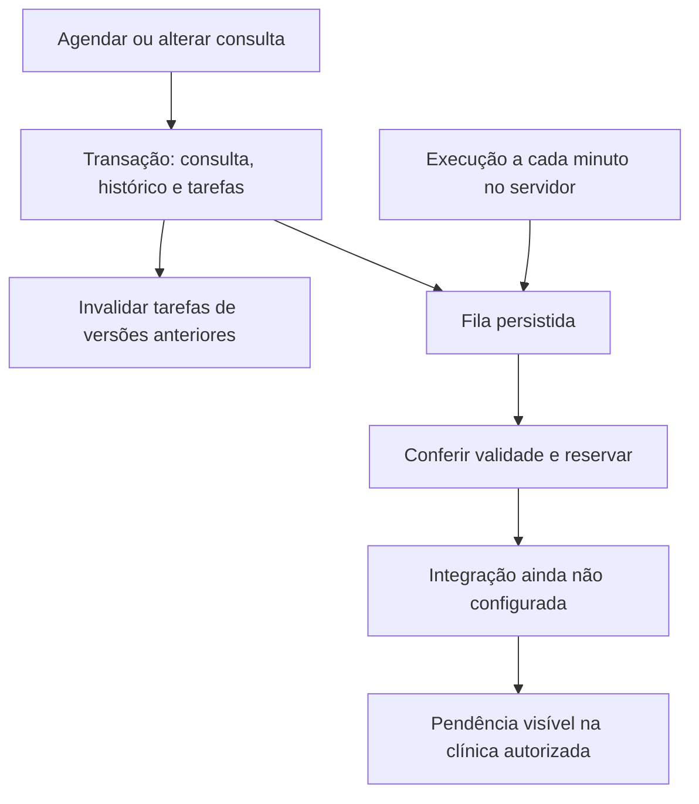

# Base de automações — etapa 020

Esta etapa prepara tarefas persistidas para Google Agenda e lembretes de WhatsApp. Não configura contas externas, não sincroniza eventos e não envia mensagens. O processador registra a pendência de integração, sem marcar uma entrega fictícia como concluída.

## Passos implementados

1. **Registro junto à consulta.** Um gatilho cria tarefas na mesma transação que grava a consulta, seu histórico e a ocupação do horário. Se a fila falhar, toda a operação é desfeita. A migração também prepara tarefas de consultas ativas futuras já existentes, sem alterar consultas ou pacientes.
2. **Planejamento do lembrete.** O horário é às 8h da véspera no fuso da clínica. Agendamento com menos de 24 horas de antecedência ou feito após esse horário não programa lembrete tardio. Confirmação mantém o planejamento elegível; reagendamento recalcula. A elegibilidade de horário não constitui autorização para enviar mensagens.
3. **Validade por versão.** Cada tarefa referencia clínica, consulta, versão e tipo. Alterações invalidam tarefas antigas, incluindo suas reservas abertas. Cancelamento deixa somente a tarefa atual para solicitar remoção do evento Google; lembretes antigos são cancelados. Conclusão e falta não produzem lembretes novos.
4. **Reserva temporária.** O processador reserva uma tarefa por dois minutos, com token novo a cada tentativa. Outro processador não consegue reservar a mesma tarefa nesse período. Finalização exige clínica e token correspondentes; repetição da finalização não altera o resultado.
5. **Recuperação e tentativas.** Falha transitória de sincronização agenda repetição progressiva de 30, 60, 120 e 240 segundos, com limite de cinco tentativas. Reserva expirada é recuperável para a sincronização que deverá usar identificador estável no adaptador futuro. Resultado externo incerto fica bloqueado para análise. Reserva expirada de WhatsApp também fica bloqueada, evitando repetição sem conhecer o resultado. Falha transitória de WhatsApp recebe `retry_policy_pending`, pois sua política de repetição ainda não foi acordada.
6. **Execução no servidor.** `private.process_foundation_jobs(25)` processa lotes limitados e registra a última execução. Nesta base, finaliza reservas como `integration_not_configured`. No PostgreSQL com `pg_cron` disponível, a migração agenda essa função a cada minuto. O navegador pode permanecer fechado.
7. **Acompanhamento.** `/automacoes` mostra tarefas autorizadas da clínica; `/minhas-automacoes` mostra somente a agenda própria. A lista é paginada em 50 tarefas, mostra versão, horário, tentativas, situação e motivo. Os detalhes da consulta possuem um atalho para suas tarefas. Não há botão de repetir uma integração ausente: é necessário configurar o adaptador antes de reativar essas tarefas.

## Estrutura e permissões

`private.automation_tasks` guarda referências e estado da tarefa. `private.automation_attempts` preserva reservas e resultados das tentativas. `private.automation_worker_state` guarda somente o horário e a quantidade processada na última execução.

Essas tabelas possuem RLS e não concedem leitura ou escrita direta aos clientes, incluindo a chave técnica. Nenhuma tarefa armazena nome do paciente, telefone, CPF, conteúdo de mensagem, detalhes de calendário ou credencial. Dados do destinatário deverão ser obtidos e validados no momento do envio, junto da autorização para mensagens.

`api.list_automations` verifica sessão, clínica ativa e funções atuais em cada leitura, e registra `automation.viewed` na auditoria. Dev lê somente o contexto selecionado; médico lê somente sua agenda. Tokens de reserva não são retornados aos usuários.

`api.claim_automation` e `api.finish_automation` são exclusivos da função técnica `service_role`, sempre com clínica explícita. A chave técnica não deve ser colocada no navegador. O processador SQL agendado executa como proprietário do banco; sua função não é concedida aos usuários nem à chave técnica. Nesta etapa, nenhum segredo adicional é necessário para o agendamento SQL.

Antes de reservar e finalizar, o banco confere versão, prazo, situação da consulta, clínica ativa e vínculo atual do médico. A remoção do evento de consulta cancelada continua elegível para limpeza mesmo após desativação do médico. Consulta é bloqueada antes da tarefa em todas as operações, evitando inversão da ordem de bloqueios.

## Fluxo

## Estados

| Estado | Significado |
|---|---|
| `pending` | Aguardando o horário e o processador |
| `processing` | Reserva temporária ativa |
| `retry` | Nova tentativa programada |
| `blocked` | Exige configuração ou análise |
| `failed` | Falha permanente ou limite atingido |
| `cancelled` | Tarefa invalidada ou expirada |
| `completed` | Reservado para o adaptador futuro; a base não aceita esse resultado |

Tentativas contam processamento técnico, não envios reais. A aceitação de uma mensagem pelo fornecedor tampouco comprovará entrega. As próximas integrações precisam implementar identificador estável, validação do destinatário, autorização para mensagens, reconciliação de resultados incertos e retornos autenticados. Não existe transação única entre PostgreSQL e o fornecedor externo, nem garantia geral de entrega exatamente uma vez.

## Operação e testes

A migração de agendamento usa o job `integraconsultas-foundation`. Em uma instalação sem `pg_cron`, deve-se configurar um agendador do servidor para chamar a função; o ambiente embarcado de testes não oferece execução em segundo plano. O horário da última execução aparece na interface. Lotes e reservas são limitados; tarefas bloqueadas não geram ciclos contínuos de tentativas.

Os testes SQL cobrem planejamento no fuso, elegibilidade, autorização, reservas, repetição, expiração, invalidação, falhas, limite de tentativas e rollback conjunto de consulta e tarefa. Os testes de navegador usam Supabase descartável, conferem isolamento e processadores simultâneos e verificam a tela em largura de celular. O agendador é pausado apenas no preparo desse ambiente de testes, para tornar as verificações determinísticas.

Fonte de operação: [Supabase Cron — quickstart](https://supabase.com/docs/guides/cron/quickstart). Segurança, isolamento, integridade, auditoria e restauração de backups permanecem condições de lançamento.
