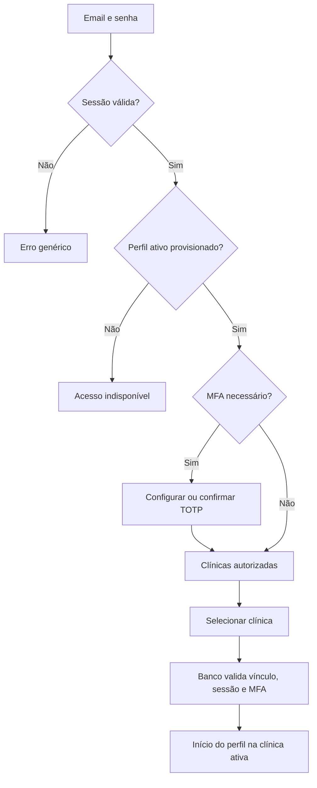

# Base web e autenticação

Escopo da branch `011-base-web-autenticacao`, acordado em 02/10/2026.

## Implementação

Next.js 16, TypeScript e Supabase Auth. Entrada por email/senha, saída da sessão atual, recuperação de senha e TOTP obrigatório para Dev e administradores. Médicos e recepção com autenticador previamente configurado também precisam confirmar o segundo fator.

Somente contas provisionadas em app.users entram no sistema. Cadastro público continua desativado. Papéis e vínculos são consultados no banco; metadata editável pelo usuário não concede privilégios.

O primeiro Dev foi provisionado em desenvolvimento após criação da credencial pelo titular. Dados pessoais, senha e identificadores da conta não integram migrations nem fixtures. O titular configura seu autenticador no primeiro acesso. Recuperação por perda de autenticador exige procedimento de verificação de identidade a definir antes do lançamento.

## Fluxo

A página inicial mostra módulos em preparação. Médico com recepção mantém escopo próprio. Dev escolhe uma clínica de cada vez e não recebe exportação por ser Dev.

## Segurança

- Cliente Supabase novo por requisição, somente chave publicável.
- Proxy verifica assinatura do token e atualiza cookies; páginas protegidas consultam Auth com getUser.
- api.session_profile() retorna apenas identidade ativa da sessão, inclusive sinalização de MFA antes da etapa de segundo fator.
- api.workspace() retorna apenas clínica selecionada e papéis atuais. Ambas são SECURITY INVOKER, search_path vazio e execução restrita a authenticated.
- RLS e helpers verificam vínculo, usuário ativo, sessão existente e MFA; revogação vale mesmo com JWT antigo.
- Respostas de sessão não são armazenadas em cache compartilhado. O proxy preserva cabeçalhos de cache da biblioteca SSR.
- Auth funciona no servidor; cookies de sessão são HttpOnly e SameSite=Lax, com Secure em origens HTTPS. Não há cliente Auth no navegador que dependa de ler esses cookies.
- Callback aceita PKCE ou token de convite/recuperação, com origem fixa, sem destino externo fornecido pelo usuário.
- Erros de login e recuperação não revelam se um email existe.
- Definição de senha exige sessão válida, confirmação e 12–128 caracteres; ao concluir encerra todas as sessões.

Abas da mesma sessão compartilham seleção de clínica. Sessões diferentes mantêm seleções independentes. Módulos futuros devem revalidar clínica e permissão no servidor em cada operação.

## Executar

Requer Node.js 22+ e pnpm 11.19.0.

1. pnpm install --frozen-lockfile.
2. Copiar .env.example para .env.local.
3. Preencher NEXT_PUBLIC_SUPABASE_URL, NEXT_PUBLIC_SUPABASE_PUBLISHABLE_KEY e APP_ORIGIN.
4. pnpm dev; abrir http://127.0.0.1:3000/entrar.

Para desenvolvimento hospedado usar URL e chave publicável do IntegraConsultas-dev. Nunca usar chave secret/service_role na aplicação. Autorização depende da sessão e do banco.

APP_ORIGIN é origem fixa sem caminho. HTTPS é obrigatório fora de localhost/127.0.0.1. Supabase Auth deve permitir exatamente <APP_ORIGIN>/auth/confirmar para recuperação. Não usar curingas em produção.

A configuração de redirecionamento e entrega de email no projeto hospedado ainda precisa ser validada. O SMTP padrão possui restrições. Testes locais com token de recuperação não comprovam entrega de emails no ambiente hospedado. SMTP próprio, URL pública e validação de entrega permanecem pendentes.

O advisor hospedado sinaliza proteção contra senhas vazadas desativada. O [recurso do Supabase](https://supabase.com/docs/guides/auth/password-security#password-strength-and-leaked-password-protection) exige plano Pro ou superior; nenhum plano pago foi ativado. O tratamento dessa limitação é pendência de segurança para lançamento. O aviso INFO sobre private.clinic_contexts sem policy é intencional: acesso direto é negado; somente helpers internos controlam o contexto.

## Verificação

pnpm typecheck, pnpm build e pnpm db:test verificam tipos, compilação e 55 asserções SQL.

Testes de navegador com Supabase descartável:

1. pnpm db:start e pnpm db:reset.
2. node scripts/prepare-web-tests.mjs.
3. pnpm exec playwright install chromium.
4. pnpm test:web.
5. pnpm db:stop.

A preparação rejeita URLs diferentes de http://127.0.0.1:54321. Chave administrativa e senhas aleatórias são usadas somente para preparar esse banco e ficam em arquivo ignorado. Não executar fixtures no projeto hospedado.

A integração contínua verifica entrada/saída, médico com recepção, MFA administrador/Dev, conta não provisionada, isolamento com JWTs reais, revogação de vínculo/sessão e definição de senha por recuperação.

## Limites

Agenda, pacientes, WhatsApp, Google Agenda, exportação e interface administrativa de cadastro ficam para próximas etapas. Este incremento não comprova todos os critérios de lançamento ou conformidade integral com LGPD. Auditoria da seleção de clínica existe; auditoria completa de acesso/operações e restauração de backups permanecem critérios obrigatórios.
