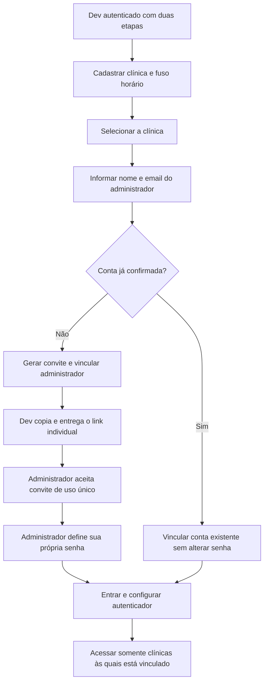

# Cadastro de clínicas e administradores

Escopo da branch `012-cadastro-clinicas-administradores`: o Dev cadastra uma clínica e, depois de selecioná-la, vincula administradores. Agenda, pacientes e cadastro dos demais perfis continuam em etapas futuras.

## Fluxo

## Autorização e integridade

Cada operação verifica a identidade no Supabase Auth, a validade da sessão no banco, o cadastro ativo, o perfil Dev armazenado no banco e o nível de autenticação `aal2`. A vinculação exige que a clínica informada seja a clínica selecionada naquela sessão. Recepção, médico e administrador não podem executar estes cadastros globais.

As funções expostas em `api` delegam a funções privadas com contexto controlado. Escrita direta nas tabelas continua bloqueada. Cada cadastro recebe um identificador de operação: repetir a mesma operação com os mesmos dados devolve o resultado anterior; reutilizar o identificador com dados diferentes é recusado. Cadastro e auditoria do banco são atômicos.

A conta criada recebe apenas o papel de administrador naquela clínica. Não recebe Dev. Contas ou vínculos inativos não são reativados automaticamente. Uma conta confirmada mantém sua senha e, quando já possui cadastro no sistema, seu nome global. Os eventos `clinic.created` e `administrator.linked` registram ator, clínica, alvo e identificador da operação, sem senha ou token de convite.

## Convite e senha

A função `provision-administrator` usa a credencial privilegiada exclusivamente para gerar o convite no Auth. Valida o JWT com `getUser` e as permissões com as funções do banco antes de gerar o convite; a concessão final também verifica o contexto. O cadastro de papéis utiliza a identidade do Dev, sem contornar as permissões com a credencial privilegiada.

O link é entregue manualmente pelo Dev, sem email automático. O segredo fica no fragmento `#token=`, que não é enviado no endereço HTTP. A tela remove esse fragmento do histórico imediatamente e só consome o convite quando a pessoa confirma o aceite. O convite é pessoal, expira conforme a configuração do Auth e só pode ser aceito uma vez. Não compartilhar em grupos nem registrar em chamados, logs ou Git.

O administrador escolhe a senha, entra e configura seu próprio autenticador. Nenhuma senha deve passar pelo Dev. O link aparece somente no resultado do cadastro; recarregar a página o descarta. Repetir o cadastro de uma conta ainda não confirmada permite gerar outro convite. Repetir para conta confirmada não redefine sua senha.

Auth e concessão de acesso pertencem a operações distintas: uma falha depois da criação da identidade pode deixar uma conta pendente sem acesso à clínica. Nesse caso, tentar novamente. O sistema não remove automaticamente a identidade, pois ela pode ter sido usada por outra clínica durante a operação.

## Ambiente e validação

`APP_ORIGIN` determina a origem do link e deve ser HTTPS público para uso externo. No desenvolvimento com `http://127.0.0.1:3000`, o link funciona apenas no computador onde a aplicação está executando. Publicação web, SMTP e recuperação de senha em produção permanecem pendentes.

Os testes utilizam contas fictícias e Supabase local descartável. Cobrem isolamento, Dev com MFA, clínica selecionada, repetição de operações, conta inativa, convite, senha definida pelo destinatário, rejeição de convite já usado, preservação da senha de conta existente e rejeição de chamadas anônimas ou feitas pela recepção. Não criam clínicas ou administradores reais no ambiente hospedado.

A função verifica a autorização internamente; `verify_jwt=false` desliga apenas a verificação automática do gateway, não permite acesso anônimo ao cadastro. Falhas retornam mensagens genéricas. Logs de argumentos de ações e requisições do Next em desenvolvimento ficam desativados. Na hospedagem, manter também a ocultação de segredos nos logs da plataforma e proxies.
