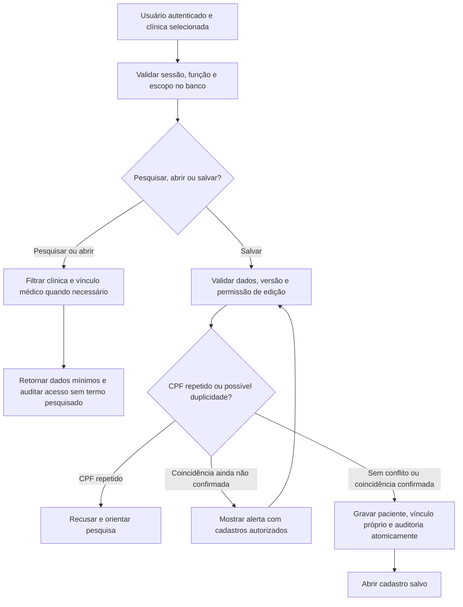
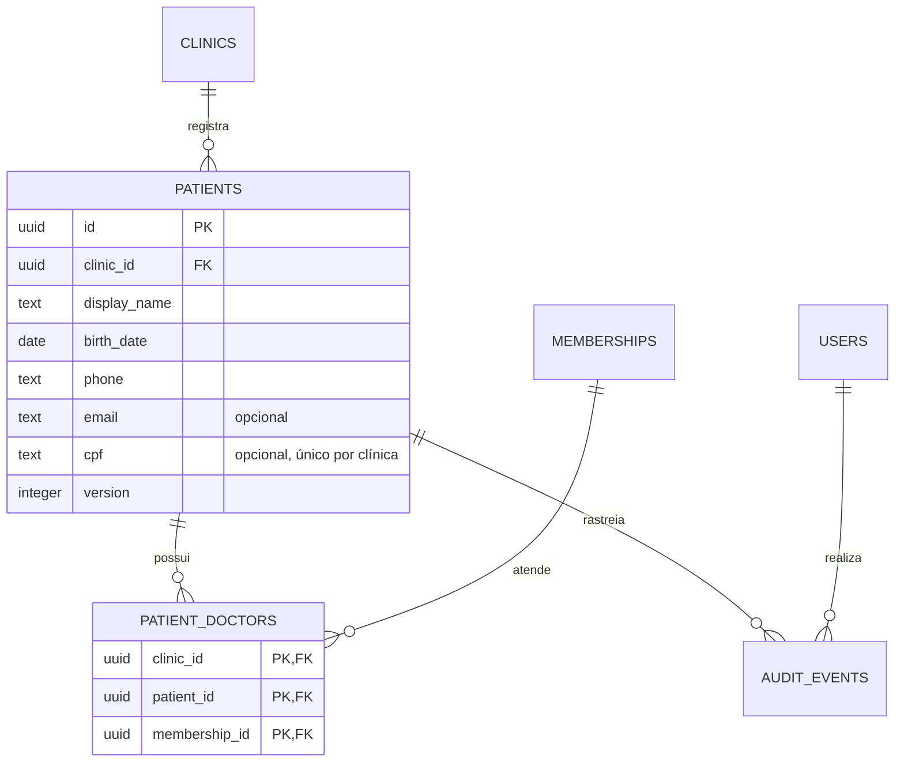

# Cadastro de pacientes por clínica

A etapa `016-cadastro-pacientes` implementa cadastro, pesquisa, consulta e edição dos dados mínimos do paciente. Agenda, prontuário, responsáveis, exportação e envio de mensagens não fazem parte desta entrega.

## Dados e validação

Nome completo, data de nascimento e telefone/WhatsApp são obrigatórios. Email e CPF são opcionais. O nome é aparado e os espaços são normalizados; buscas por nome ignoram maiúsculas e os acentos portugueses mais comuns. Nascimento deve ser uma data válida, não futura no fuso da clínica. Telefone é guardado em formato internacional: números brasileiros de 10 ou 11 dígitos sem `+` recebem `55`; números internacionais usam `+` e código do país. Validar formato não comprova titularidade, existência do número ou disponibilidade do WhatsApp.

CPF recebe validação de tamanho, dígitos verificadores e rejeição de sequência repetida; isso não consulta a Receita nem comprova identidade. Um CPF não vazio é único **dentro da clínica**, sem compartilhar cadastro com outra clínica. Email vazio e CPF vazio são armazenados como nulos. Não são coletados endereço, diagnóstico, documentos anexos ou anotações clínicas nesta etapa. CPF é opcional e deve ser preenchido somente quando necessário para identificação pela clínica, com finalidade definida.

Telefone igual ou nome normalizado e nascimento iguais produzem aviso de possíveis duplicidades, com até três cadastros **visíveis ao solicitante**. A pessoa confere e pode confirmar o salvamento: telefone familiar não é identificador único. Ao editar, o aviso é reavaliado quando telefone, nome ou nascimento usados na comparação mudam; editar outros campos não exige reconfirmar coincidências já existentes. CPF repetido não permite sobreposição por confirmação. Cadastros não são mesclados nem vinculados automaticamente pelo CPF ou telefone.

## Permissões

| Perfil na clínica ativa | Consulta | Cadastro | Edição |
|---|---|---|---|
| Administrador | Todos os pacientes da clínica | Sim | Sim |
| Recepção com escopo clínica | Todos os pacientes da clínica | Sim | Sim |
| Médico | Somente pacientes vinculados a ele na clínica | Não | Não |
| Médico com recepção própria | Somente pacientes vinculados a ele | Cadastro vinculado ao próprio médico | Cadastro próprio não compartilhado |
| Dev isolado | Pacientes da clínica explicitamente selecionada | Não | Não |

Médico com recepção não atribui pacientes existentes a si nem edita cadastro compartilhado entre médicos; nesses casos solicita alteração à recepção da clínica ou administração. A política de edição compartilhada segue pendente na [matriz de permissões](permissoes.md). Um paciente novo criado no escopo próprio recebe vínculo ao médico que o cadastrou, preparando seu atendimento futuro. Médicos sem recepção apenas consultam os dados mínimos dos pacientes já vinculados.

Administrador que também é médico mantém a administração: **Pacientes da clínica** mostra a clínica toda, e **Meus pacientes** aplica adicionalmente o vínculo ao seu próprio perfil médico. O segundo módulo continua aparecendo somente quando a função médica está ativa naquela clínica. No fluxo de cadastro por **Meus pacientes**, o paciente é vinculado ao próprio médico; pelo fluxo de administração, não se presume qual médico irá atender.

Vínculos de atendimentos futuros serão acrescentados pelo módulo de agenda em rotinas internas autorizadas; não existe API que permita ao cliente escrever diretamente em `patient_doctors`. O cadastro não concede acesso à história clínica nem resolve regras de retenção de vínculos após o último atendimento. Essas regras permanecem para definição antes do módulo correspondente.

## Interface e privacidade

O início oferece **Abrir pacientes** à recepção, administração e Dev. Médicos usam **Abrir meus pacientes**. Listas possuem 25 registros por página e exibem nome, nascimento, telefone e somente o sufixo do CPF. CPF completo e email são apresentados ao abrir o cadastro autorizado. É possível pesquisar por nome, telefone, email ou CPF; buscas não vazias exigem pelo menos três caracteres.

Pesquisa e salvamento usam Server Actions por POST. Termos pesquisados, nomes, CPF e telefone não são incluídos na URL. Endereços de cadastro usam identificador UUID opaco e não substituem autorização. A aplicação mantém `Cache-Control: private, no-store`, `Referrer-Policy: no-referrer` e não registra parâmetros de Server Functions ou solicitações nos logs do servidor. Não há analytics nem envio de dados a terceiros neste fluxo.

O aviso de duplicidade preserva os campos preenchidos. Alterar um campo invalida a confirmação visual anterior, e o banco reavalia os dados recebidos. Após salvar, a tela abre o cadastro persistido. Edição usa uma versão esperada; se outra pessoa alterou o cadastro, a gravação é recusada e a pessoa precisa atualizar e conferir os dados, evitando perda silenciosa de alterações.

## Arquitetura e banco

`app.patients` e `app.patient_doctors` possuem RLS, chaves compostas por clínica e índices de nome/nascimento, telefone e vínculo médico. Clientes `anon`, `authenticated` e `service_role` não recebem leitura ou escrita direta nas novas tabelas. A API expõe wrappers `SECURITY INVOKER`; funções privadas com `SECURITY DEFINER` e `search_path` vazio validam sessão viva, usuário ativo, clínica ativa, MFA exigida e as funções reais no banco. Não usam `user_metadata` como autorização.

As rotinas de leitura aplicam o escopo antes de retornar registros, páginas, detalhes ou coincidências. Usuário em duas clínicas e Dev também precisam de contexto explicitamente selecionado. Médico com recepção não ganha leitura de outros pacientes por alterar parâmetros no navegador. Funções privadas não aceitam identidade de ator fornecida pelo cliente.

Salvamento bloqueia a operação, o usuário e o vínculo, revalida permissões e utiliza bloqueio transacional curto por clínica para conferir duplicidades e versão. Não faz chamadas externas durante a transação. A restrição única de CPF também protege a integridade no banco. Mesma operação com dados normalizados iguais retorna o resultado anterior; a reutilização com outros dados é recusada. Replays não reativam acesso revogado.

Auditoria registra `patient.created`, `patient.updated`, `patient.viewed` e `patient.searched`, com clínica, ator, instante e identificador do paciente quando aplicável. Criação e edição usam SHA256 do pedido normalizado, incluindo identificador aleatório da operação, para idempotência. Auditoria não recebe nome, CPF, telefone, email, valores anteriores/novos ou termo pesquisado. O hash não deve ser tratado como dado anônimo. O identificador do paciente é referência composta à mesma clínica e a auditoria permanece sem edição pelos usuários.

## Validação e limites para lançamento

Os testes usam PostgreSQL e Supabase descartável, sem inserir pacientes reais no projeto hospedado. Cobrem campos inválidos, duplicidade confirmável, unicidade de CPF, pesquisa com acentos, paginação, versões concorrentes, idempotência, vínculos próprios, pacientes compartilhados, alteração de contexto, metadata maliciosa, MFA, acesso revogado e auditoria. Testes web também verificam normalização, preservação de formulário, duas edições simultâneas e duas criações concorrentes com o mesmo CPF.

Esta entrega aplica controles técnicos de minimização, autorização e rastreabilidade; não constitui declaração de conformidade jurídica. Seguem necessários aviso de privacidade, finalidades e bases legais por atividade, representação de menores, atendimento de direitos, retenção/descarte, contratos e revisão antes da produção, conforme [privacidade e segurança](privacidade-seguranca.md). Não se presume autorização de WhatsApp por cadastrar um telefone; destinatário, responsáveis e autorização de mensagens serão implementados antes dos lembretes. Exportação e exclusão não são oferecidas nesta etapa.

Isolamento, segurança, integridade da agenda, auditoria e restauração de backups continuam sendo condições obrigatórias do lançamento, conforme [qualidade de lançamento](qualidade-lancamento.md). A agenda ainda não foi implementada e as condições de produção não são consideradas concluídas por este módulo.
