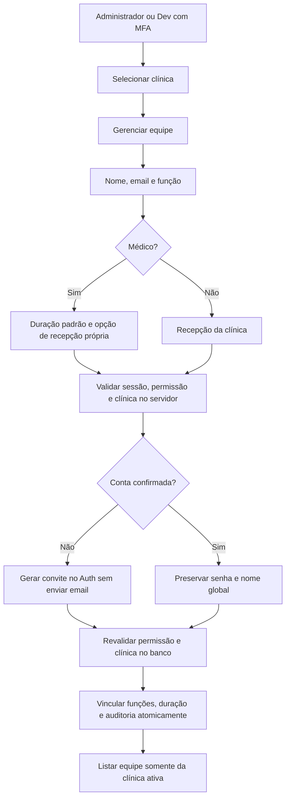
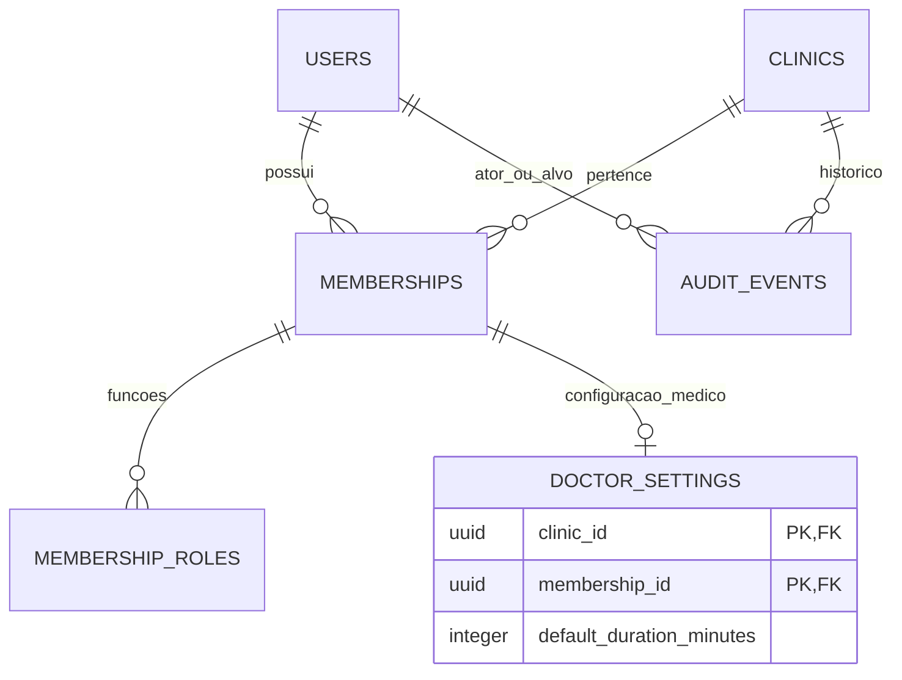

# Cadastro de médicos e recepção

A etapa `014-cadastro-medicos-recepcao` permite ao administrador com MFA cadastrar e vincular médicos e recepção somente na clínica selecionada. O Dev com MFA também pode gerenciar a equipe daquela clínica. Recepção e médicos, inclusive médicos com função de recepção, não gerenciam usuários.

## Cadastro e acesso

A tela **Equipe da clínica**, acessível por **Gerenciar equipe** no início, recebe nome, email e função. Para médico, oferece duração padrão de 15, 30, 45 ou 60 minutos (30 inicialmente selecionado) e a opção **Também exerce a função de recepção**. A duração é armazenada por vínculo médico/clínica; exceções na duração de consultas serão implementadas no módulo de agenda.

O papel `doctor` tem escopo `own`. A recepção comum recebe `reception/clinic`. Quando o mesmo vínculo possui `doctor` e `reception`, o banco mantém ambos com escopo `own`, inclusive quando a função de recepção é adicionada posteriormente a um médico ou um médico é cadastrado sobre um vínculo existente de recepção. Papéis de outra clínica não são modificados. O cadastro acrescenta funções, preserva administração já existente e não remove funções implicitamente.

Uma nova conta recebe convite individual de uso único e define sua própria senha no fluxo existente `/convite` → `/definir-senha` → `/entrar`. O administrador copia e entrega o link pessoalmente; nenhum email é enviado. Contas já confirmadas mantêm a senha atual, nome global e outros vínculos. Repetir cadastro pendente gera outro convite e invalida o link anterior da mesma conta Auth. O segredo aparece apenas na tela, é removido do endereço no aceite e não entra na auditoria ou no Git.

Usuários e vínculos inativos não são reativados. A gestão da equipe não altera identidades Dev nem concede os papéis Dev ou administrador. Alteração de funções, desativação e cancelamento de convites da equipe ficam para uma etapa específica; o cancelamento já implementado para convites de administradores permanece no painel Dev.

## Arquitetura e banco

`app.doctor_settings` tem chave composta e referência composta ao vínculo da mesma clínica. A duração aceita somente as quatro opções acordadas. RLS permite ao administrador ler configurações de sua clínica ativa e ao médico ler a própria configuração. Não há escrita direta para clientes. As funções `api.list_team`, `api.team_candidate`, `api.team_clinic_context` e `api.link_team_member` são wrappers `SECURITY INVOKER`; as funções privadas verificam identidade ativa, sessão viva, MFA, contexto selecionado e perfil autorizado antes de qualquer acesso privilegiado. Anônimos não recebem permissão de execução.

`provision-team` valida o JWT com Auth e verifica a permissão no banco antes de gerar convite. A credencial privilegiada fica na função e é usada somente no Auth. Vínculos e configurações são escritos com o JWT do solicitante, com nova verificação de contexto após a chamada externa. `verify_jwt=false` desliga apenas a verificação automática do gateway; a autenticação e autorização internas são obrigatórias.

O evento `team.linked` registra clínica, ator, alvo e identificador de operação, sem senha ou token. A repetição idêntica é idempotente; reutilizar a operação com dados diferentes é recusado. O Auth e o banco não compartilham transação: falha depois de gerar convite pode deixar uma identidade pendente sem vínculo. Tentar novamente; não excluir automaticamente uma conta que pode pertencer a outra clínica.

## Validação e limites

Os testes utilizam PostgreSQL e Supabase local descartável, sem criar usuários reais no ambiente hospedado. Verificam cadastro pelo administrador, MFA, papéis permitidos, duração, isolamento, idempotência, preservação de contas, ausência de escrita direta, convite aceito pelo destinatário e acesso próprio do médico com recepção. Chamadas anônimas e de médico com recepção são recusadas antes da criação de identidades.

O módulo de agendamento, cadastro de pacientes, sincronização Google e lembretes WhatsApp continuam nas próximas etapas. Os papéis cadastrados constituem a base de autorização desses módulos; esta entrega não cria agendas ou pacientes.
