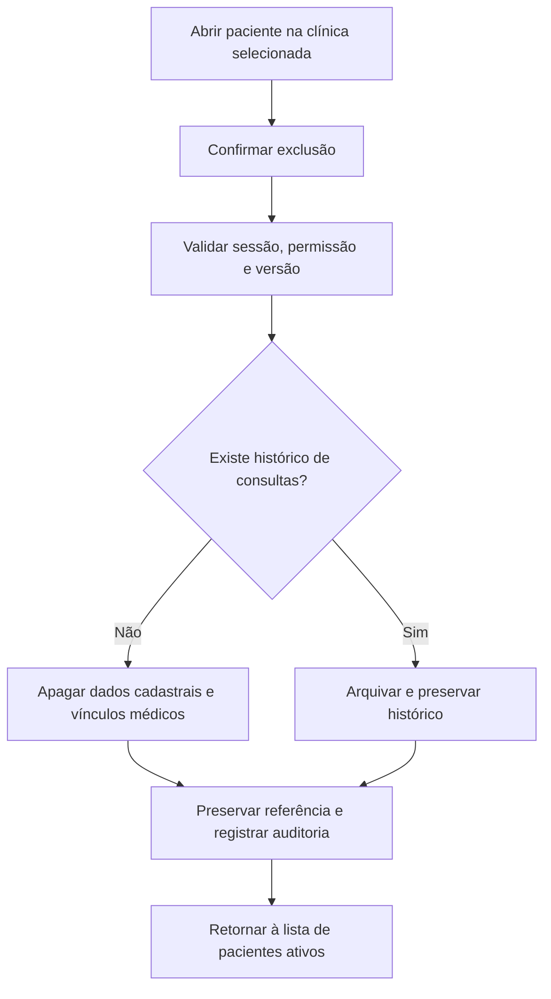
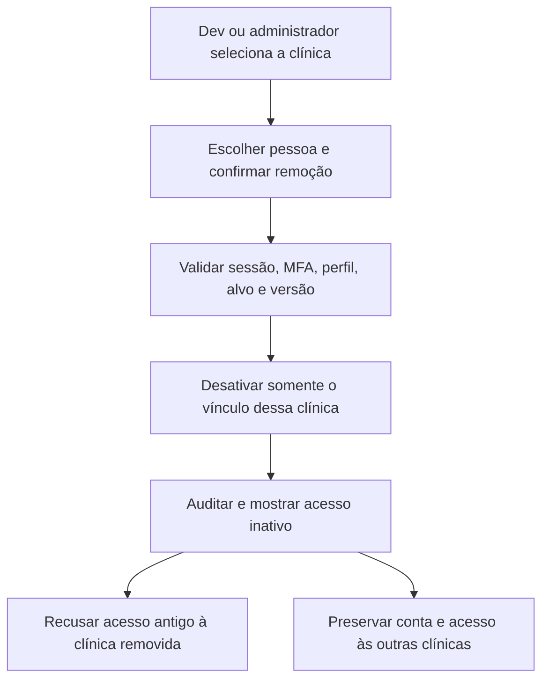

# Exclusão de pacientes e remoção de acesso por clínica

A branch `017-exclusao-pacientes-remocao-equipe` acrescenta duas operações distintas. Ambas exigem confirmação na tela, contexto explícito da clínica, sessão válida e autorização atual no banco. Nenhuma conta do Supabase Auth é apagada por estas operações.

## Pacientes

Administração e recepção com escopo da clínica veem **Excluir cadastro** ao abrir o paciente. Médico, médico com recepção própria e Dev isolado não recebem esta permissão. Um administrador que também é médico mantém sua permissão administrativa.

O primeiro clique abre uma confirmação que identifica o paciente e a clínica. A pessoa marca **Entendi e confirmo esta ação** e confirma, ou usa **Voltar**. O cadastro precisa continuar na versão que foi aberta: se outra pessoa o editou, a exclusão é recusada até atualizar a página e conferir os dados.

Sem consultas vinculadas, a operação apaga a linha de `app.patients` e seus vínculos médicos. Nome, nascimento, telefone, email e CPF deixam de existir no cadastro ativo. Uma referência opaca em `app.patient_references`, contendo UUID e clínica, mantém os alvos de auditoria anteriores sem alterar os eventos. UUID excluído não pode ser reutilizado. Esta referência não é dado anônimo e permanece protegida.

Com histórico de consultas, o cadastro recebe `archived_at`; seus dados e vínculos são preservados para o histórico. Cadastros arquivados deixam de aparecer na pesquisa e não podem ser abertos ou editados pelas rotas de cadastro, inclusive por UUID direto. CPF arquivado não impede novo cadastro ativo. Não há restauração ou gerenciamento de arquivados na interface nesta etapa.

A agenda ainda não existe. `has_consultation` é um marcador interno, permanente, de retenção na referência do paciente. A futura transação de agenda **deve chamar `private.retain_patient_for_consultation` antes de registrar a primeira consulta**, na mesma transação, sem permissão de execução para clientes. A rotina e a exclusão usam o mesmo bloqueio curto por clínica, evitando vínculo de consulta com paciente já excluído. O módulo de agenda também deverá acrescentar sua referência composta por clínica ao banco; a integração desse contrato é condição para sua entrega. Os testes representam histórico apenas no ambiente descartável.

Auditoria acrescenta `patient.deleted` e `patient.archived`. A ação, seu resultado e a auditoria são atômicos; repetição da mesma operação por ator autorizado retorna o resultado anterior. A chave não pode ser reutilizada com outro alvo ou versão. Pedido de edição anterior não recria um paciente excluído ou arquivado.

Excluir cadastro não é um fluxo completo de atendimento de direitos da LGPD: regras de retenção por finalidade, cópias de segurança, documentos, histórico clínico, responsáveis e solicitações formais permanecem na documentação de privacidade. Não se promete eliminação de backups ou de registros legalmente necessários por este botão.

## Equipe e administradores

| Operação | Quem pode executar | Alvo |
|---|---|---|
| Remover administrador da clínica | Dev com MFA | Vínculo administrativo da clínica selecionada, incluindo suas funções acumuladas |
| Remover médicos e recepção | Administrador da clínica com MFA | Vínculo da equipe que não acumule administração |

**Remover da clínica** desativa `app.memberships.active`, sem apagar a identidade, suas funções históricas, configuração médica, pacientes ou auditoria. Todas as funções daquele vínculo perdem acesso naquela clínica; outras clínicas continuam funcionando. Mesmo o último administrador pode ser removido pelo Dev, que permanece capaz de cadastrar outro administrador. O administrador da clínica não pode remover administradores por meio da lista de médicos.

O botão não aparece para vínculo já inativo, o próprio usuário ou conta Dev. O banco também bloqueia a remoção do próprio acesso e a remoção de Dev. A opção não constitui edição de uma função isolada: se uma pessoa acumula médico e recepção, ambas perdem o acesso à clínica.

Uma sessão já aberta não mantém a autorização: as rotinas atuais consultam o vínculo ativo no banco, invalidando o contexto removido sem encerrar sessões globais de outras clínicas. A pessoa pode selecionar outra clínica autorizada com sua conta existente.

Convite pendente e remoção de vínculo são operações diferentes. O vínculo inativo impede acesso à clínica mesmo após o aceite de um link ainda válido. **Cancelar convite** mantém seu fluxo existente de invalidação do convite; a remoção não promete invalidar links globais nem desativar a conta em outras clínicas.

`access_version` muda ao alterar a situação ativa do vínculo. A remoção exige a versão atual e grava `administrator.removed` ou `team.removed`. Repetição do mesmo pedido é idempotente, mas nunca remove novamente um vínculo restaurado posteriormente. Não há botão de reativação nesta entrega; o cadastro existente também não reativa automaticamente um vínculo removido.

## Fluxos

## Verificação

Testes SQL verificam isolamento, perfis, idempotência, auditoria, versões, exclusão real, arquivamento, ausência de escrita direta e revogação com JWT anterior. Testes web usam contas e pacientes fictícios no Supabase descartável para confirmação e cancelamento, versão desatualizada, exclusão e arquivamento, remoção da equipe e remoção de administrador com funções acumuladas. Nenhuma conta ou paciente real é removido como teste.
