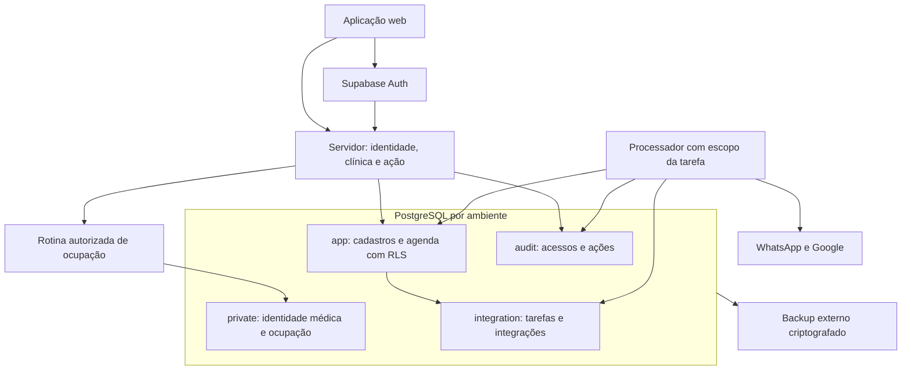
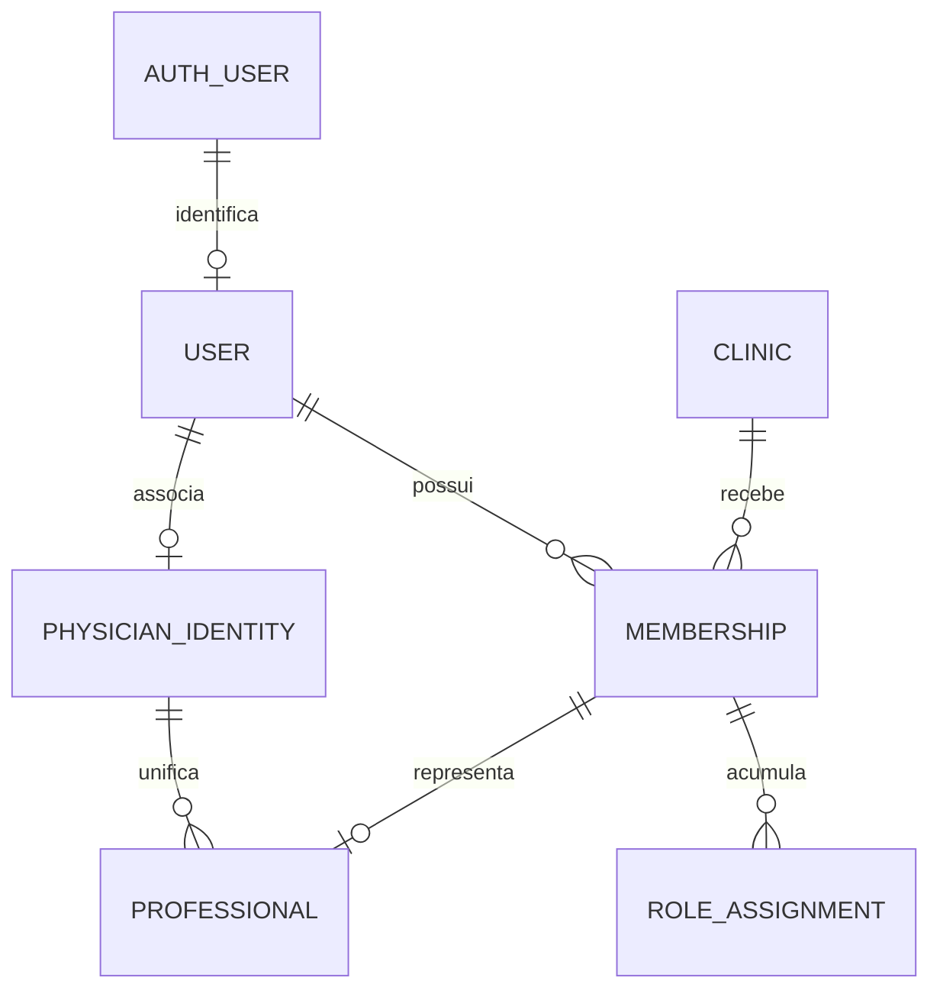
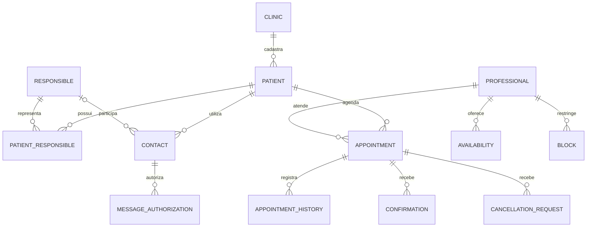
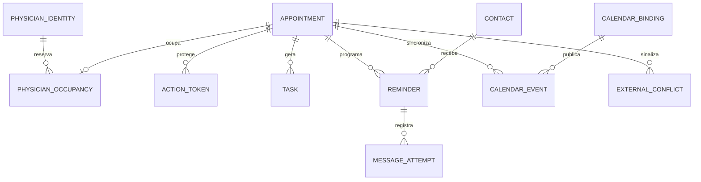
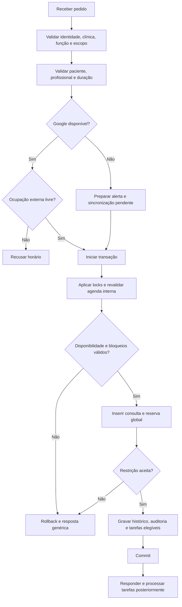
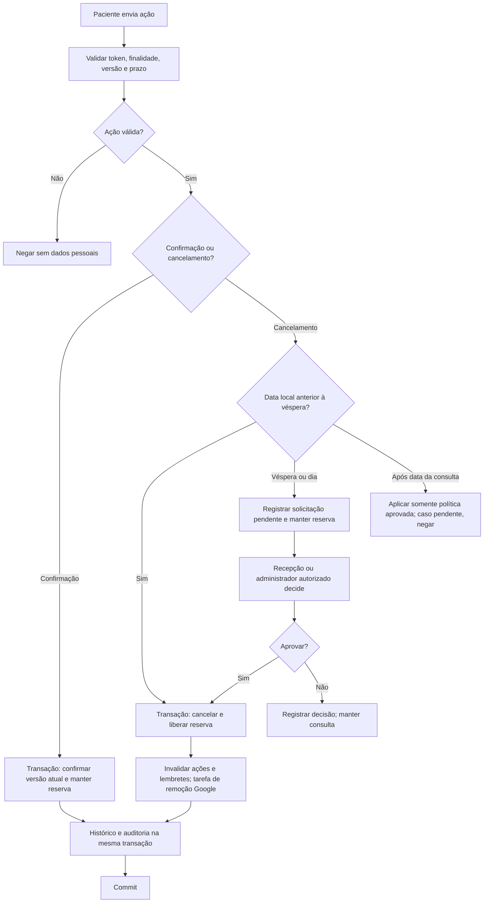
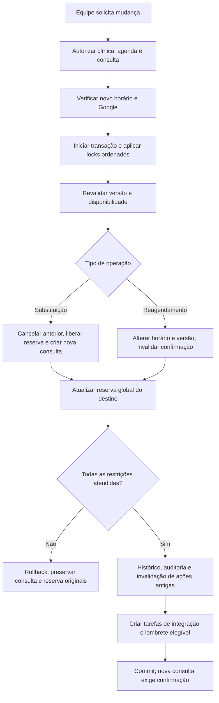
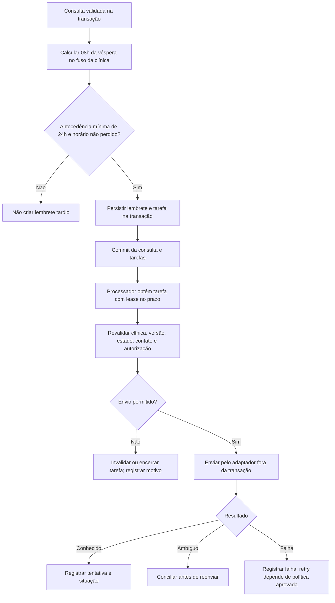
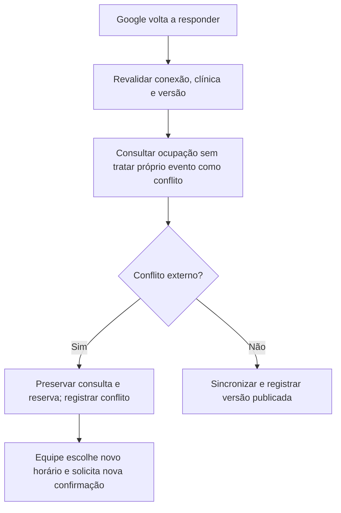
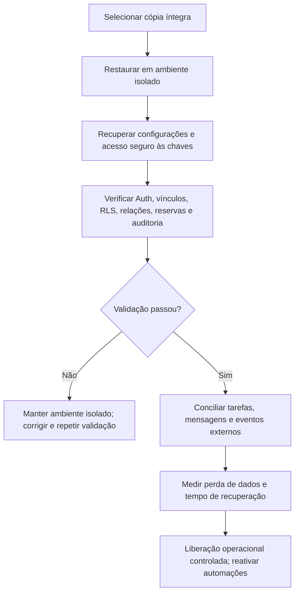

# Diagramas e fluxogramas do banco

Data: 02/10/2026. Proposta para revisão; não representa banco implementado. Leia junto com [arquitetura do banco](arquitetura-banco.md) e [modelo lógico](modelo-dados.md).

Diagramas divididos por domínio para facilitar leitura. Cardinalidades mostram estrutura, não permissões. clinic_id é obrigatório nos registros operacionais mesmo quando omitido na figura.

## 1. Arquitetura e limites de acesso

As setas representam dependências e operações autorizadas, não grants. O processador revalida recursos da clínica; não recebe acesso irrestrito por causa da automação. A fronteira transacional está dentro do PostgreSQL.

## 2. Identidade e clínicas

AUTH_USER pertence ao Supabase; USER é a identidade da aplicação. Um usuário possui vínculos independentes. PHYSICIAN_IDENTITY é privada e exige verificação/deduplicação; email e nome não comprovam identidade médica única.

## 3. Pacientes e agenda

Paciente, responsável, contato e consulta pertencem à mesma clínica. Uma solicitação de cancelamento não altera o estado até ser decidida.

## 4. Ocupação e processamento

Consulta agendada ou confirmada tem uma reserva ativa. Outros estados não mantêm reserva. TASK referencia versão; confirmação, tokens e tarefas antigas são invalidados no reagendamento. Configurações completas de integração estão no modelo lógico.

## 5. Criar agendamento

Falha em qualquer gravação antes do commit desfaz toda a operação. O Google pode mudar após a verificação; sincronização posterior deve detectar conflito. Não existe transação distribuída com o Google.

## 6. Confirmar e cancelar

Revalidar versão/estado na decisão da equipe. Se houver reagendamento após solicitação, não cancelar a nova versão silenciosamente. Outras transições dependem da matriz e das regras aprovadas.

## 7. Substituir ou reagendar

Substituição requer opção explícita e recepção/administrador no escopo autorizado. Nunca cancelar consulta de outra clínica para liberar o médico. Comunicação da consulta substituída e referência temporal do lembrete reagendado continuam pendentes.

## 8. Lembrete e execução

A regra funcional não autoriza lembrete tardio. Limite operacional de processamento e retries precisa ser aprovado. Troca de versão cancela o processamento antigo. Não prometer entrega exatamente uma vez pelo fornecedor.

## 9. Recuperação Google e restauração

Um dump padrão não é presumido completo. Backups e configurações têm cobertura documentada em [Supabase](supabase.md). Retenção, frequência e metas continuam pendentes.
