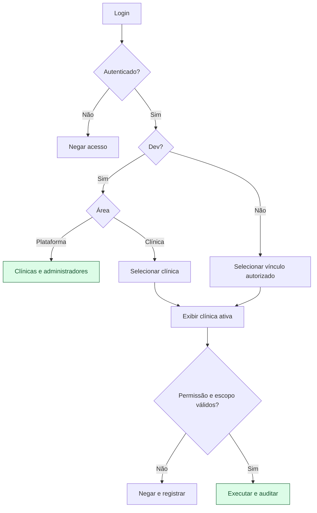
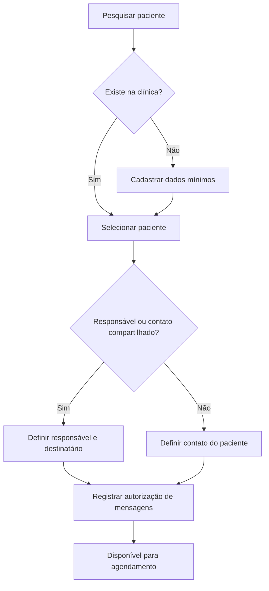
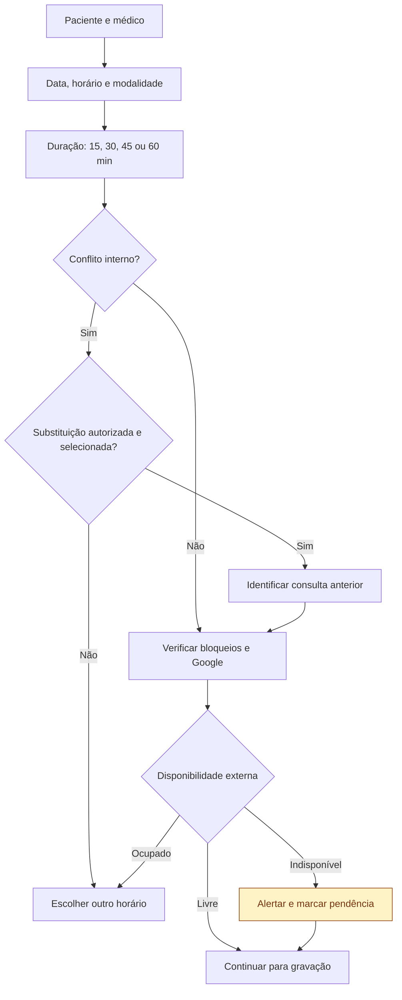
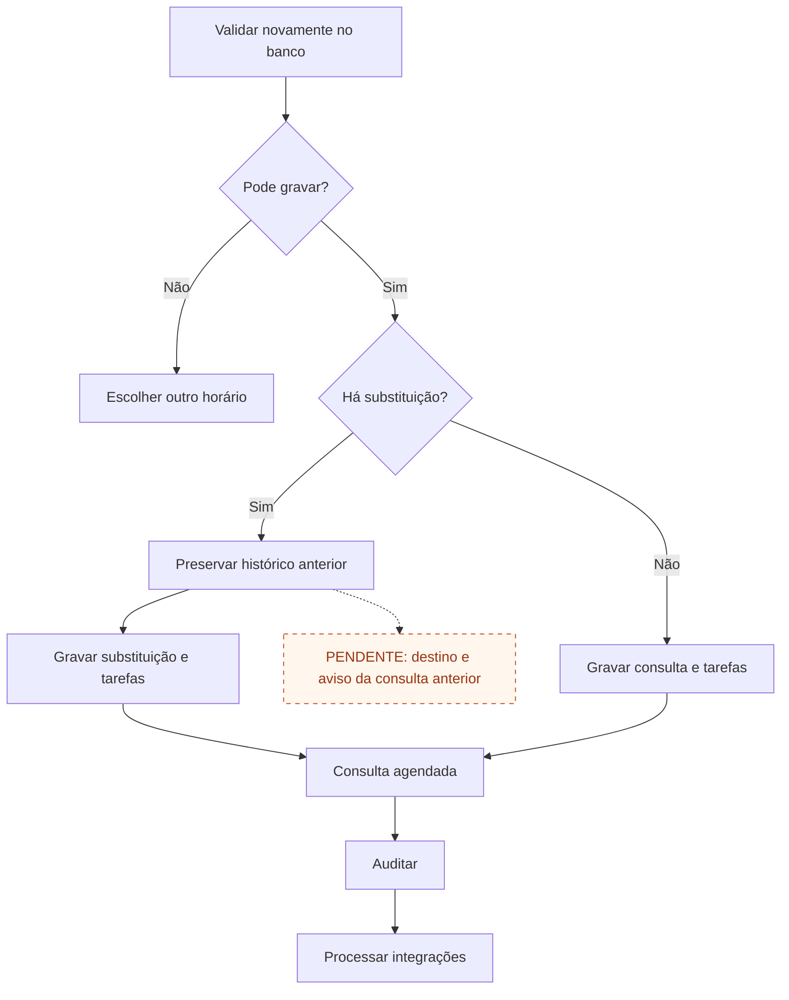
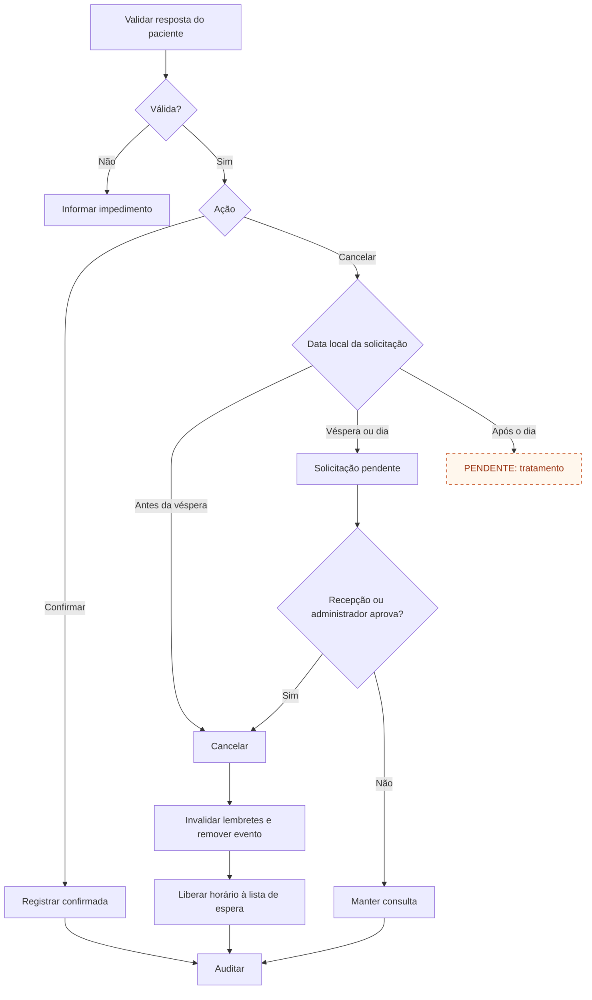
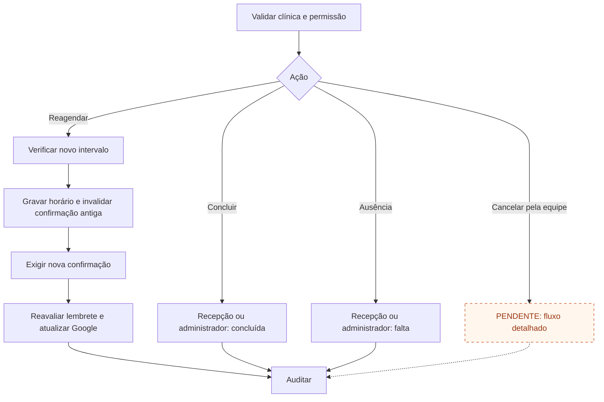
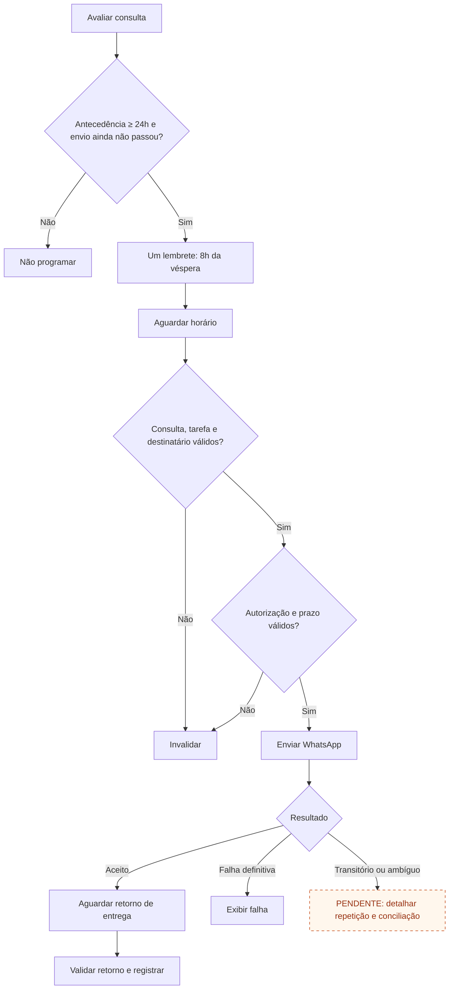
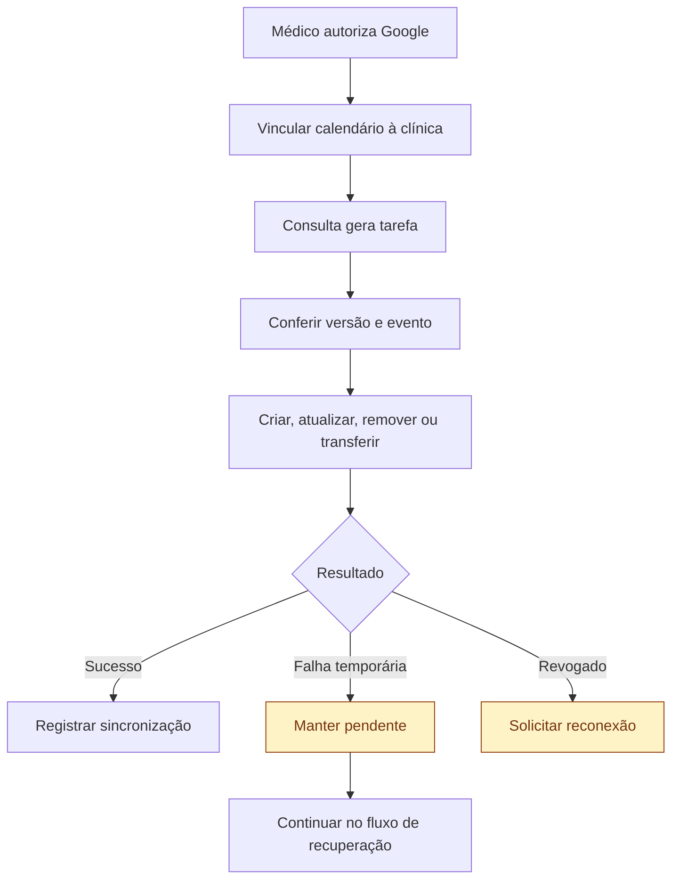
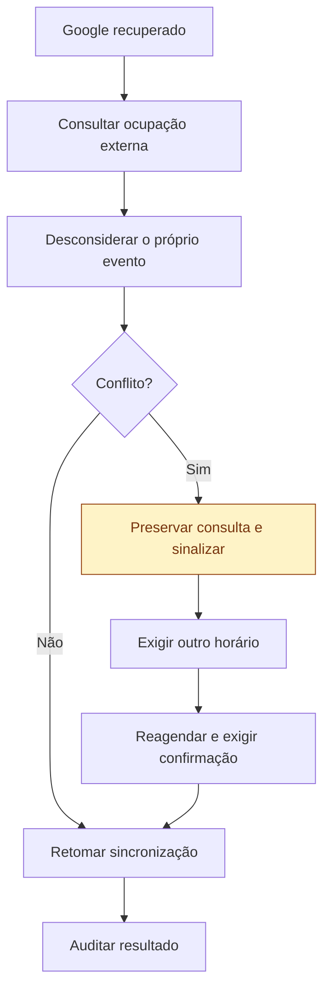

# Fluxogramas do sistema

Status: documentação dos fluxos acordados; não representa funcionalidades implementadas.
Base: [requisitos funcionais](requisitos-funcionais.md). Decisões não resolvidas estão identificadas como pendentes.

## Leitura dos diagramas

Caixas representam ações; losangos, decisões. Pendências aparecem com a palavra **PENDENTE**, borda tracejada e fundo laranja. Alertas usam fundo amarelo. A cor complementa o texto, sem ser o único indicador. Explicações e limites funcionais permanecem abaixo dos diagramas. Continuação entre diagramas evita setas de retorno excessivamente longas.

## 1. Acesso e visão geral

| Perfil | Áreas permitidas |
|---|---|
| Dev | Administração global ou dados de uma clínica selecionada |
| Administrador | Profissionais, recepção, pacientes, agendas, relatórios e logs da própria clínica |
| Médico | Própria agenda e pacientes dos próprios atendimentos |
| Recepção | Cadastro, edição e pesquisa de pacientes, consultas, agendamento e bloqueios da clínica |
| Médico com recepção | Gestão somente da própria agenda |

Seleção de clínica não substitui autorização no servidor. Trocar de clínica exige novo contexto e validação. Dados não são agregados entre clínicas na visão operacional do Dev.

## 2. Pacientes e responsáveis

Não pesquisar pacientes de outras clínicas. Critérios de identificação, representação de menores e acesso detalhado ainda precisam ser especificados.

## 3. Agendamento, encaixe e substituição

### 3.1. Gravação e substituição

Substituição libera o horário da consulta anterior e cria a nova sem duas consultas ativas sobrepostas. Deve preservar histórico, invalidar lembretes antigos e atualizar eventos. Recepção e administrador podem substituir dentro do escopo. Estado final da consulta substituída e notificações permanecem pendentes. Não substituir compromissos pessoais do Google nem ignorar outros bloqueios.

A etapa de validação final protege contra concorrência interna; não garante disponibilidade externa imutável entre a consulta ao Google e a gravação.

## 4. Confirmação e cancelamento pelo paciente

Exemplo: consulta na quinta-feira permite cancelamento automático até terça-feira. Quarta e quinta exigem aprovação. Solicitação pendente é um registro separado, não um novo estado da consulta. Notificações e regras para consultas concluídas ou com falta ainda serão detalhadas.

## 5. Reagendamento e encerramento

Concluída e falta não serão definidas automaticamente pela simples passagem do horário. Recepção e administrador registram conclusão ou falta. Reagendamento exige nova confirmação. Transições detalhadas permanecem pendentes.

## 6. Lembretes em segundo plano

Programar somente um lembrete às 8h da véspera. Não enviar para agendamentos com menos de 24 horas nem criar envio tardio quando o horário previsto já passou. Distinguir envio inicial tardio de repetição após falha: a política de repetição ainda está pendente. Interromper tentativas após cancelamento ou horário da consulta. Mensagem aceita não significa entregue. Consulta concluída, com falta ou tarefa de versão anterior não deve disparar lembrete. Políticas de repetição, ambiguidades e alertas serão detalhadas. Funcionamento independe do navegador.

## 7. Google Agenda

### 7.1. Recuperação após indisponibilidade

Consulta de ocupação externa é um fluxo separado da publicação de eventos. Após indisponibilidade, retomar verificação e atualização; sinalizar conflitos e exigir outro horário, preservando a consulta sem apagá-la automaticamente. Conflito não constitui um sexto estado da consulta. Excluir eventos do próprio sistema da interpretação de conflito consigo mesmos.

Proposta inicial: alterações manuais no Google não alteram consultas do IntegraConsultas. Publicar título genérico, horário e link autenticado, sem dados identificáveis do paciente por padrão.

## 8. Escopo futuro e pendências

- Autoagendamento: versão futura, opcional por clínica; regras ainda não definidas.
- Lista de espera: cadastro e aproveitamento de vagas acordados; ordem de contato acordada, mas significado operacional, elegibilidade e reserva pendentes.
- Consultas recorrentes: inclusão ainda não decidida.
- Fluxos não aprovados não são inferidos como permissões implementáveis.
- Segurança, isolamento entre clínicas, integridade, auditoria e restauração de backups continuam condições obrigatórias de lançamento.

Recepção e administrador podem editar pacientes e bloquear horários no escopo autorizado. Exportação é exclusiva do administrador. Forma do link online continua para decisão posterior.

## Rastreabilidade

| Diagramas | Requisitos |
|---|---|
| Acesso | RF-01 a RF-10, RF-36, RF-40, RF-41 |
| Pacientes | RF-11, RF-21, RF-24 |
| Agendamento | RF-12 a RF-19, RF-32, RF-37 |
| Confirmação e cancelamento | RF-13, RF-16, RF-20, RF-26 |
| Reagendamento e encerramento | RF-12, RF-13, RF-26, RF-31, RF-38, RF-39 |
| WhatsApp | RF-22 a RF-29 |
| Google | RF-30 a RF-34, RF-37 |
