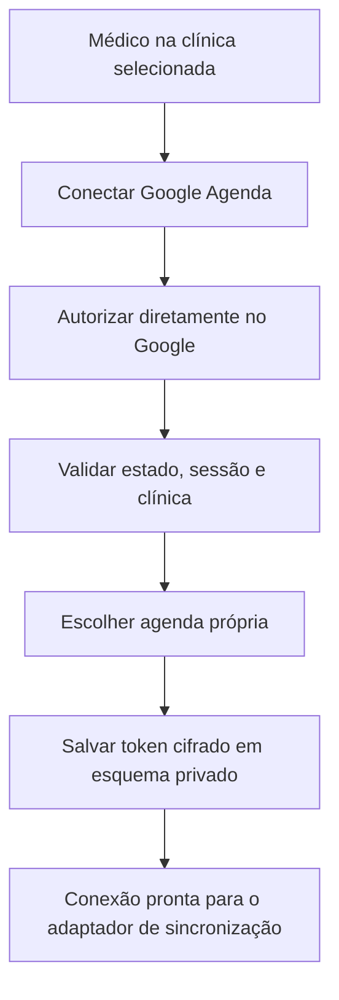

# Google Agenda — conexão individual, etapa 021

O projeto Google Cloud `integraconsultas` tem a Google Calendar API ativada e um cliente OAuth de desenvolvimento. O aplicativo está em modo de testes. A conta responsável pode ser substituída posteriormente por uma conta institucional, através das permissões do projeto.

Esta primeira parte implementa autorização e seleção da agenda. **Ainda não cria, altera ou remove eventos, nem consulta conflitos de agendamentos.** A fila da etapa 020 continua registrando pendências. A etapa 021 permanece em desenvolvimento até integrar o adaptador e validar a sincronização.

## Passos disponíveis

1. O médico entra no IntegraConsultas, seleciona uma clínica e abre **Configurar Google Agenda**. Administradores com função médica também podem acessar. Recepção, administrador sem função médica e Dev não conectam agendas em nome de outras pessoas.
2. O botão solicita autorização diretamente no Google, com consentimento explícito, acesso em segundo plano e PKCE S256. A senha Google não passa pelo IntegraConsultas.
3. O retorno valida estado aleatório, sessão ativa, usuário, clínica e função médica. O estado tem prazo de dez minutos e só pode ser consumido uma vez.
4. O usuário escolhe uma agenda própria. O servidor confere novamente a lista de agendas antes de salvar; uma agenda enviada manualmente no formulário não amplia o acesso.
5. O servidor guarda o token de renovação cifrado com AES-256-GCM, associado à clínica e ao médico como dados autenticados. A chave de criptografia fica no ambiente do servidor, fora do banco.
6. O médico pode desconectar somente o próprio vínculo da clínica. Isso remove a credencial local e preserva consultas, eventos Google existentes e outras clínicas. Revogação de acesso na Conta Google pode afetar todas as conexões do aplicativo.

## Configuração do servidor

Copiar somente os nomes das variáveis de `.env.example`. Configurar `GOOGLE_CLIENT_ID`, `GOOGLE_CLIENT_SECRET`, `GOOGLE_TOKEN_ENCRYPTION_KEY` e `SUPABASE_SERVICE_ROLE_KEY` no servidor. A última variável aceita a chave técnica moderna `sb_secret_`; seu nome não implica obrigação de usar JWT legado. Nenhuma delas deve usar prefixo `NEXT_PUBLIC_`. A chave de criptografia precisa de 32 bytes aleatórios, representados por 64 caracteres hexadecimais; preservá-la de forma segura para restauração e rotação planejada. Alterá-la sem recifrar tokens existentes impede a recuperação das conexões.

Retorno OAuth: `${APP_ORIGIN}/integracoes/google/retorno`. Para o desenvolvimento atual: `http://127.0.0.1:3000/integracoes/google/retorno`. Configurar um cliente separado com endereço HTTPS estável para produção. Não presumir que o cliente local está autorizado para um domínio futuro.

Escopos: `calendar.calendarlist.readonly`, `calendar.events.owned` e `calendar.freebusy`. Eles permitem listar agendas, trabalhar com eventos de agendas próprias e consultar disponibilidade. O aplicativo não solicita administração geral de agendas ou alteração de compartilhamento. A conexão não copia pacientes ou consultas nesta parte.

O médico deve estar na lista de usuários de teste do Google Cloud. Em modo de testes, a autorização e o token de renovação podem expirar em sete dias para esses escopos. Antes da operação regular, preparar domínio, política de privacidade, publicação e verificação exigida pelo Google. Não publicar automaticamente durante os testes.

## Segurança e verificação

`private.google_connections` e `private.google_oauth_requests` são tabelas não expostas, com RLS e sem leitura direta, inclusive pela função técnica. RPCs públicas de usuário conferem a clínica selecionada e o perfil médico; retornam apenas metadados ou estado da solicitação. A gravação definitiva é exclusiva do servidor e exige prova temporária validada, sessão ativa, contexto e vínculo atual. Tokens, códigos OAuth e nomes de agendas não entram na auditoria; a auditoria registra `google.connected` e `google.disconnected`.

Cookies temporários são cifrados e HttpOnly, SameSite=Lax, Secure em HTTPS, limitados ao caminho da integração e a dez minutos. Depois do retorno, o código Google sai da URL; respostas têm no-store e no-referrer. Logs de solicitações do Next estão desativados na configuração existente. Chamadas Google têm prazo de doze segundos, erros genéricos sem conteúdo de credenciais e lista paginada limitada.

Testes: SQL de autorização, isolamento, estado consumido, expiração, função técnica e auditoria; testes de cifra autenticada, adulteração, vínculo à clínica, PKCE, escopos e seleção de agenda. Testes de navegador em Supabase descartável conferem acesso por perfil e retorno inválido sem chamadas reais ao Google. O teste real de consentimento deve ser feito pelo titular da conta; não usar credenciais pessoais nos testes automatizados.

Fontes: [Google OAuth para aplicações web](https://developers.google.com/identity/protocols/oauth2/web-server), [escopos Calendar API](https://developers.google.com/workspace/calendar/api/auth), [Supabase — funções e permissões](https://supabase.com/docs/guides/database/functions).
