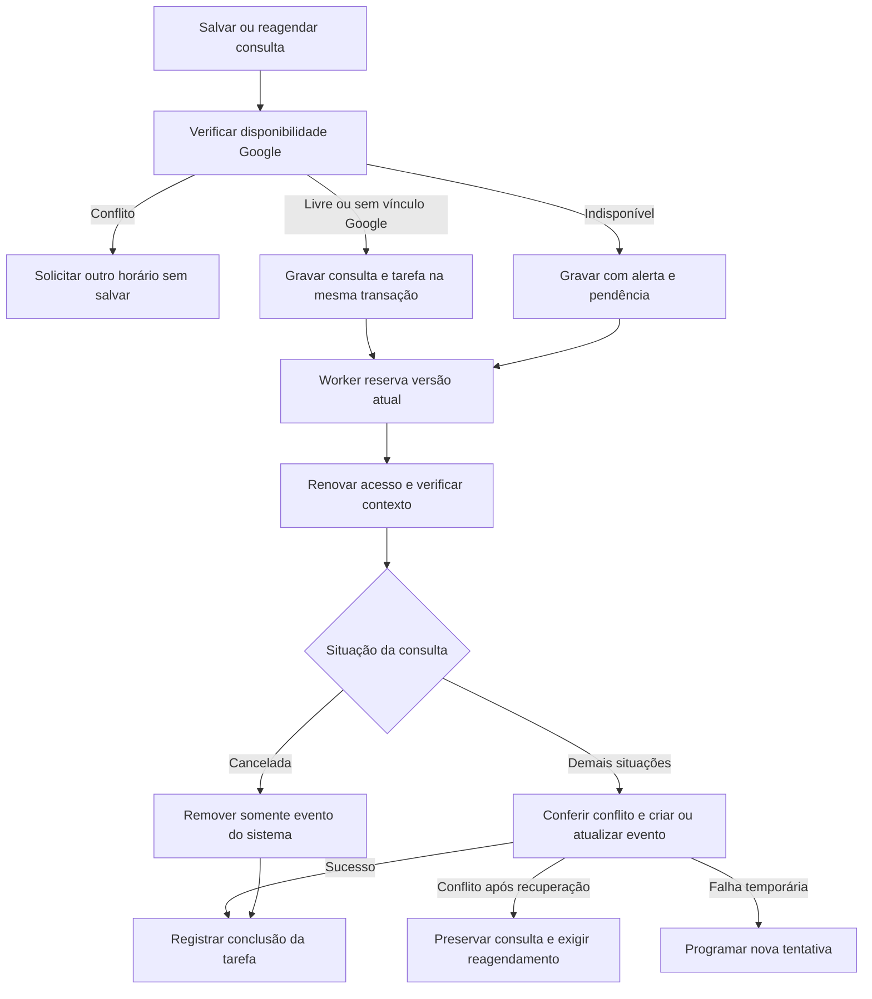

# Google Agenda — sincronização, etapa 022

O IntegraConsultas é a origem dos dados da consulta. A integração envia somente um título genérico, horário, privacidade e identificador técnico do evento. Não inclui nome, telefone, email, diagnóstico ou outros dados do paciente; não adiciona convidados nem envia convites ou notificações do Google. WhatsApp continua inativo.

## Fluxo

Agendada e confirmada continuam ocupando o horário no banco. Reagendamento volta a agendada e exige nova confirmação. Conflito Google é uma pendência de sincronização, sem adicionar outro estado à consulta ou apagá-la. A consulta substituída é cancelada; a nova consulta ignora somente o evento da consulta que substitui, enquanto a remoção anterior é processada.

A verificação ocorre antes de salvar, com conversão do horário pelo fuso da clínica. O banco continua responsável por impedir sobreposição interna, inclusive do mesmo médico em clínicas diferentes. A verificação Google não é uma reserva atômica: um usuário do Google pode criar outro evento entre a consulta de disponibilidade e a gravação. O worker confere novamente e sinaliza o conflito.

## Processamento e recuperação

A fila usa versão da consulta, reserva temporária e até cinco tentativas, com atrasos de 30, 60, 120 e 240 segundos. Um ciclo processa no máximo três clínicas/tarefas, uma reserva por vez; não consome lembretes WhatsApp. O processador anterior deixa as tarefas Google com conexão disponível para o novo worker. Conexão nova libera pendências que aguardavam configuração.

O identificador Google é determinístico por clínica e consulta. Atualizações e exclusões verificam a marca privada do sistema e usam ETag/If-Match. A versão gravada no evento impede atualização de versão anterior. Conexão, vínculo e versão são conferidos novamente imediatamente antes da chamada externa. Tarefas canceladas em processamento impõem uma espera limitada antes da próxima reserva da mesma consulta.

Não existe transação única entre PostgreSQL e Google. Uma interrupção entre gravação externa e conclusão da fila será recuperada pelo identificador estável, quando a tarefa ainda for atual. Corridas com expiração da reserva e cancelamento durante uma chamada externa exigem verificação operacional; não declarar consistência distribuída instantânea ou certificação de lançamento. Alterações manuais no Google não alteram o IntegraConsultas; conflitos após um evento já sincronizado exigem nova checagem/reconciliação, planejada para evolução posterior.

## Execução

`pnpm worker:google` executa o mesmo adaptador no servidor local enquanto o processo estiver aberto. `pnpm worker:google --once` executa um ciclo. O processo usa `.env.local`, sem imprimir tokens. Não executar teste de massa contra o Supabase hospedado.

Para operação online, a função `google-sync` usa autenticação própria por segredo aleatório de pelo menos 32 bytes. JWTs de usuário e chaves públicas não autorizam o worker. Configurar `GOOGLE_WORKER_SECRET`, `GOOGLE_CLIENT_ID`, `GOOGLE_CLIENT_SECRET` e a mesma `GOOGLE_TOKEN_ENCRYPTION_KEY` nas variáveis protegidas da função. A chave de criptografia permanece fora do banco.

O agendador chama a função a cada minuto. Configurar no Vault apenas `integraconsultas_google_worker_url` e `integraconsultas_google_worker_secret`, com o segredo do worker correspondente. Sem essas duas configurações, a função de despacho retorna falso e não faz chamadas externas. Não guardar segredo em migration, Git, log ou frontend. A ativação online depende de disponibilizar esses segredos; preparar e revisar antes de ativar. Restaurar os tokens exige preservar também a chave de criptografia em backup seguro independente.

## Verificação

Testes locais com PostgreSQL descartável cobrem privilégios, isolamento, reserva concorrente, token incorreto, payload sem paciente, conflito preservado, reagendamento e conclusão. Testes do adaptador usam respostas sintéticas para criação, atualização, cancelamento, paginação, conflito, ETag, token revogado, duplicação e versão anterior. A CI executa os fluxos web com Supabase descartável; não usa contas pessoais Google. Um teste real de eventos deve usar uma consulta/agenda identificada como teste e conferir criação, reagendamento e cancelamento antes de liberar operação clínica.

Referências: [Google — Events insert](https://developers.google.com/workspace/calendar/api/v3/reference/events/insert), [Google — Events list](https://developers.google.com/workspace/calendar/api/v3/reference/events/list), [Supabase — agendar funções](https://supabase.com/docs/guides/functions/schedule-functions).
