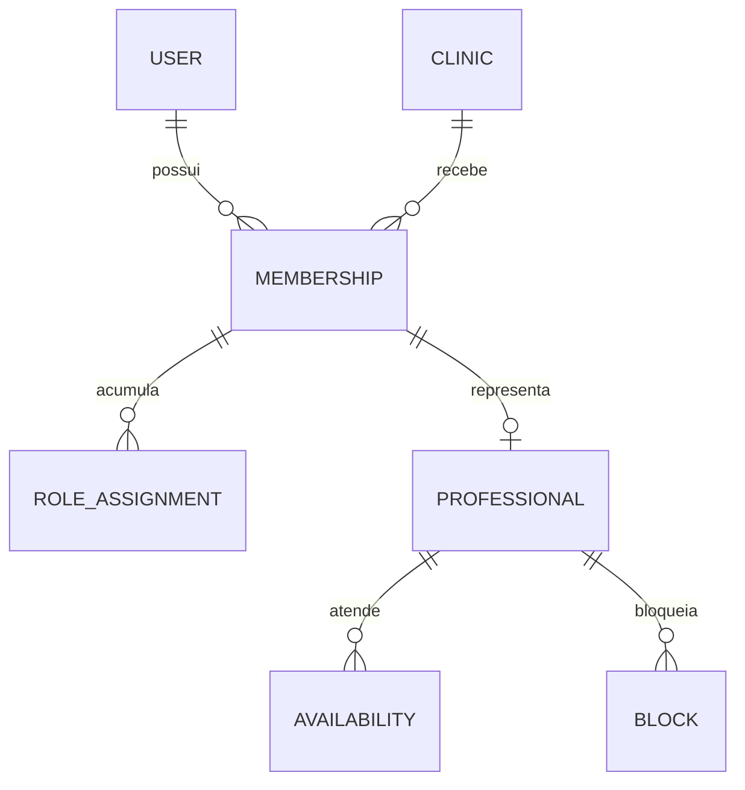
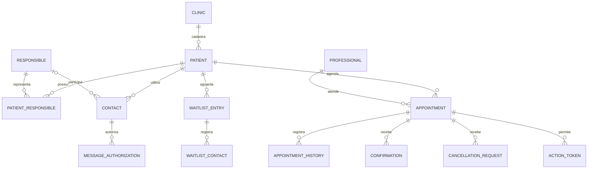
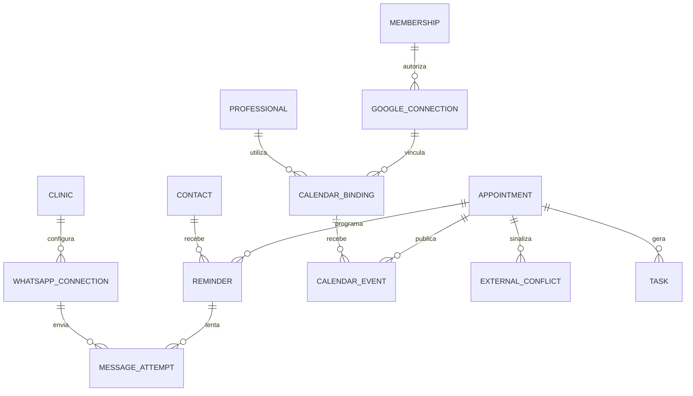

# Modelo de dados proposto

Status: modelo lógico para revisão, baseado nos [requisitos](requisitos-funcionais.md) e [fluxogramas](fluxograma-sistema.md). Não cria banco, tabelas ou migrações. Campos, tipos e restrições abaixo são propostas técnicas; decisões funcionais pendentes não são resolvidas por este documento.

## 1. Convenções

- Identificadores opacos, preferencialmente UUID.
- Entidades operacionais incluem clinic_id obrigatório, mesmo quando omitido nos diagramas.
- Instantes persistidos com referência UTC; clínica possui fuso IANA para regras por data local.
- created_at, updated_at e versão para concorrência quando aplicável.
- Relações operacionais usam pares clinic_id + id para impedir associação entre clínicas.
- Diagramas divididos por domínio; cardinalidade descreve vínculos, não autoriza acesso.
- Exclusão e retenção dependem da política aprovada; não usar remoção em cascata indiscriminada.
- Estados técnicos de tarefas e integração não são novos estados de consulta.

## 2. Identidade, clínicas e permissões

| Entidade | Campos principais propostos | Regras |
|---|---|---|
| CLINIC | id, nome, fuso, situação | Contexto de todos os dados operacionais |
| USER | id, auth_subject, nome, situação, is_dev | Identidade global; credencial gerida pela solução de autenticação a escolher |
| MEMBERSHIP | id, clinic_id, user_id, situação | Um vínculo por usuário e clínica; pode ser desativado |
| ROLE_ASSIGNMENT | id, clinic_id, membership_id, função, escopo | Funções: administrador, médico e recepção; escopo próprio ou clínica conforme regras |
| PROFESSIONAL | id, clinic_id, membership_id, duração_padrão, situação | Vínculo médico; duração em 15, 30, 45 ou 60 minutos |
| AVAILABILITY | id, clinic_id, professional_id, dia_semana, início_local, fim_local, vigência | Representa períodos de atendimento; detalhes de recorrência da disponibilidade a validar |
| BLOCK | id, clinic_id, professional_id, início, fim, categoria, created_by | Bloqueio manual; evitar motivo com dados sensíveis desnecessários |

Dev é capacidade da plataforma, não função concedida por administrador de clínica. Administração global e operação em clínica selecionada têm autorizações distintas. is_dev é representação proposta; implementação de autenticação e concessão dessa capacidade permanece em aberto.

Médico com recepção continua limitado ao próprio profissional. A combinação de funções não pode ser tratada como união automática de acesso irrestrito. Administrador tem acesso à própria clínica. Somente administrador pode exportar dados; Dev não ganha exportação implicitamente.

Uma identidade USER pode ter vários vínculos, mas PROFESSIONAL é local à clínica. Prevenção de agendamento simultâneo do mesmo médico entre clínicas exige decisão adicional sem expor dados de uma clínica à outra; não presumir disponibilidade livre por falta de visibilidade.

## 3. Pacientes, responsáveis e consultas

| Entidade | Campos principais propostos | Regras |
|---|---|---|
| PATIENT | id, clinic_id, nome, situação; demais dados mínimos a validar | Não compartilhar cadastro automaticamente entre clínicas; telefone não é identificador único |
| RESPONSIBLE | id, clinic_id, nome, situação | Responsável local à clínica |
| PATIENT_RESPONSIBLE | id, clinic_id, patient_id, responsible_id, relação, representação_verificada | Permite vários vínculos; comprovação e coleta dependem da regra aprovada |
| CONTACT | id, clinic_id, patient_id, responsible_id opcional, telefone, destinatário, situação | Contato de paciente ou responsável; permite telefone compartilhado e seleção explícita do destinatário |
| MESSAGE_AUTHORIZATION | id, clinic_id, contact_id, finalidade, canal, evidência, granted_at, revoked_at | Histórico da autorização para mensagens; não substitui base legal de outras finalidades |
| APPOINTMENT | id, clinic_id, patient_id, professional_id, início, fim, duração_minutos, estado, modalidade, endereço/link, versão, scheduled_at, created_by | Cinco estados acordados; modalidade presencial ou online |
| APPOINTMENT_HISTORY | id, clinic_id, appointment_id, versão, ação, campos_alterados, ator, occurred_at | Histórico mínimo necessário; registra reagendamento, substituição e alterações |
| CONFIRMATION | id, clinic_id, appointment_id, versão, origem, confirmed_at, invalidated_at | Confirmação válida apenas para a versão atual; reagendamento exige nova |
| CANCELLATION_REQUEST | id, clinic_id, appointment_id, versão, requested_at, resultado, decided_at, decided_by | Registro separado; decisão pela recepção ou administrador dentro do escopo |
| ACTION_TOKEN | id, clinic_id, appointment_id, versão, hash, finalidade, expires_at, consumed_at | Link seguro; guardar hash, não segredo em claro; limite e reuso dependem da ação |
| WAITLIST_ENTRY | id, clinic_id, patient_id, professional_id opcional, entered_at, situação | Não definir prioridade por ordem de entrada sem esclarecer ordem de contato |
| WAITLIST_CONTACT | id, clinic_id, waitlist_entry_id, contacted_at, resultado, actor_id | Registra contatos; algoritmo e reserva temporária pendentes |

APPOINTMENT.estado: agendada, confirmada, concluída, cancelada ou falta. Não criar estado de consulta para conflito Google ou solicitação de cancelamento.

Substituição deve relacionar consulta anterior e nova no histórico, preservar o registro anterior e liberar ocupação de forma atômica. Estado/destino da consulta anterior ainda não definido: proposta de vínculo de substituição não escolhe automaticamente cancelamento ou reagendamento.

### Regras de tempo

- início menor que fim; duração específica e padrão em 15, 30, 45 ou 60 minutos.
- fim corresponde a início + duração, sem alterar consultas antigas quando o padrão muda; esse comportamento do padrão é proposta a validar.
- Cancelamento automático: data local da solicitação anterior à data local da consulta menos um dia. Na véspera ou dia, recepção/administrador decide.
- Reagendamento altera versão, invalida confirmação e tokens antigos, registra horário anterior e refaz tarefas.
- A solicitação de cancelamento de versão anterior não deve cancelar silenciosamente uma consulta reagendada.

### Integridade da ocupação

Proposta: restrição no banco para impedir intervalos ativos sobrepostos por profissional, combinada a transação e bloqueio adequados para substituição e bloqueios. Validar disponibilidade e bloqueios na mesma operação protegida contra concorrência.

A escolha exata de quais estados ocupam agenda e das transições detalhadas precisa ser validada. Não implementar filtros de conflito baseados em suposições sobre concluída ou falta.

## 4. Comunicação e Google

| Entidade | Campos principais propostos | Regras |
|---|---|---|
| WHATSAPP_CONNECTION | id, clinic_id, fornecedor, identificador_número, secret_reference, situação | Configuração específica da clínica; não guardar credenciais nos registros técnicos |
| REMINDER | id, clinic_id, appointment_id, versão, contact_id, scheduled_for, situação | Um lembrete por versão elegível; tarefa antiga invalidada em alteração |
| MESSAGE_ATTEMPT | id, clinic_id, reminder_id, connection_id, attempt_at, resultado, provider_message_id, código_erro | Diferenciar aceito, entregue e falhou; evitar duplicar conteúdo pessoal |
| GOOGLE_CONNECTION | id, clinic_id, membership_id, account_reference, secret_reference, situação | Consentimento OAuth no contexto autorizado; revogável |
| CALENDAR_BINDING | id, clinic_id, professional_id, connection_id, calendar_id, finalidade | Distinguir calendário de publicação e consulta de ocupação; cardinalidades a validar |
| CALENDAR_EVENT | id, clinic_id, appointment_id, binding_id, event_id, desired_version, synced_version, situação | Preserva mapeamento e versão; permite atualizar, remover e transferir sem duplicar |
| EXTERNAL_CONFLICT | id, clinic_id, appointment_id, detected_at, versão, situação, resolved_at | Apenas informação necessária; sem títulos ou detalhes pessoais externos |
| TASK | id, clinic_id, appointment_id, versão, tipo, dedup_key, due_at, situação, attempt_count, locked_until, last_error_code | Tarefa persistida junto da operação de agenda; lease e deduplicação são propostas técnicas |

### Lembretes

Proposta de cálculo: scheduled_for = 08:00 da véspera no fuso da clínica, convertido para instante UTC. Elegibilidade exige pelo menos 24 horas entre agendamento e início da consulta, e horário de envio ainda não ultrapassado. Depois das 8h da véspera não criar envio tardio.

Após reagendamento, guardar instante do novo agendamento no histórico para reavaliar elegibilidade. Uso desse instante como referência de 24 horas deve ser validado antes da implementação.

Antes de enviar, verificar autorização, destinatário, clínica, versão, estado e prazo. Um lembrete não significa uma única tentativa: política de repetição continua pendente. Resposta ambígua deve ser conciliada antes de reenviar.

### Google

Guardar vínculo do evento por consulta e calendário, sem copiar dados identificáveis do paciente por padrão. Em troca de profissional ou clínica de publicação autorizada, não perder a referência do evento antigo antes da remoção confirmada. Uma consulta permanece pertencendo à sua clínica; mover consulta entre clínicas não é funcionalidade aprovada.

Ocupação externa deve ser transitória ou minimamente retida, sem títulos. Distinguir consulta concluída sem conflito de integração indisponível: ausência de dados não comprova intervalo livre.

Se a recuperação revelar conflito, preservar consulta, registrar EXTERNAL_CONFLICT e exigir novo horário. A agenda continua como fonte oficial. Ação de remoção de evento cancelado não deve ser bloqueada porque o intervalo externo está ocupado.

## 5. Auditoria

Entidade proposta AUDIT_EVENT:

| Campo | Finalidade |
|---|---|
| id, occurred_at | Identificar e ordenar ocorrência |
| clinic_id | Clínica da operação; nulo somente em operação global claramente identificada |
| actor_user_id ou service_actor | Ator humano ou processo |
| action, resource_type, resource_id | Operação e recurso |
| result, correlation_id | Resultado e rastreamento |
| changes_summary | Resumo mínimo, sem copiar tokens ou conteúdo clínico |

Administrador lê somente eventos da própria clínica. Dev acessa contexto selecionado; ações globais exigem trilha específica. Proteger escrita e leitura, impedir alteração comum e definir retenção. Exportações são ações auditadas, com minimização e permissão de administrador.

## 6. Restrições propostas

1. Unicidade de MEMBERSHIP por clinic_id + user_id.
2. Unicidade de função por vínculo e regra explícita de escopo.
3. Vínculo PROFESSIONAL corresponde a usuário com função médica ativa.
4. Chaves compostas nas relações operacionais impedem consulta com paciente ou profissional de outra clínica.
5. Validação de duração, intervalo, modalidade e estados.
6. Confirmações, ações e tarefas vinculadas à versão atual.
7. Unicidade de REMINDER por consulta, versão e tipo; política de troca de destinatário a detalhar.
8. Unicidade de dedup_key no contexto de clínica e tipo de tarefa.
9. Identificador de mensagem externo único no contexto do fornecedor/conexão quando presente.
10. event_id único no contexto do calendário/conexão, com preservação de registros necessários à remoção.
11. Índices orientados a agenda por clínica/profissional/data, tarefas pendentes por prazo, histórico e auditoria por clínica.
12. Políticas de acesso no banco e servidor; processos ampliados exigem contexto explícito.

Essas restrições são especificação proposta, não SQL validado.

## 7. Proteção de dados

- Identidade global não concede visibilidade global de pacientes.
- Contatos, responsáveis, autorização e eventos sempre pertencem à clínica.
- Referências a segredos apontam para armazenamento protegido; tokens não aparecem em auditoria.
- Não coletar CPF, diagnóstico ou documentos sem necessidade e finalidade definidas.
- Retenção, anonimização, exportação e atendimento de direitos precisam de política jurídica e operacional.
- Backups abrangem banco e configuração necessária à recuperação; restauração deve comprovar isolamento e integridade.
- Histórico deve ser suficiente para auditoria sem duplicar indefinidamente dados sensíveis.

## 8. Pendências e próximos passos

| Tema | Validar antes da implementação |
|---|---|
| Ocupação | Estados que reservam horário e conflitos do mesmo médico entre clínicas |
| Substituição | Destino da consulta anterior e comunicação ao paciente |
| Lista de espera | Significado de ordem de contato, prioridade e reserva |
| Reagendamento | Referência de tempo para elegibilidade do novo lembrete |
| Duração | Efeito de mudança do padrão |
| Google | Quantidade de calendários, compartilhamento de conexão e autenticação |
| Pacientes | Campos mínimos, representação de menores e acesso detalhado |
| Estados | Transições e cancelamento após atendimento |
| Operação | Repetição, retenção, infraestrutura e solução de autenticação |
| Futuro | Autoagendamento, recorrência e forma do link online |

Após revisão: matriz detalhada de permissões, registro das decisões arquiteturais e desenho físico/migrações em mudanças separadas. Este documento não aprova automaticamente decisões pendentes.

## 9. Rastreabilidade

| Domínio | Requisitos |
|---|---|
| Identidade e clínica | RF-03 a RF-10, RF-40, RF-41 |
| Agenda e pacientes | RF-11 a RF-21, RF-38, RF-39 |
| Comunicação | RF-22 a RF-29 |
| Google | RF-30 a RF-34, RF-37 |
| Auditoria e relatórios | RF-35, RF-36 |
