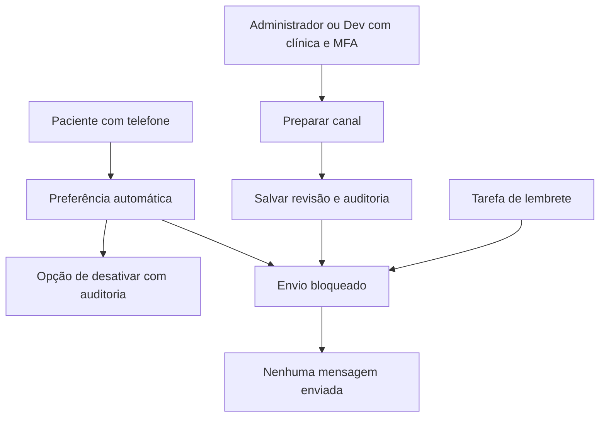

# Estrutura WhatsApp — etapa 023

Estado em 09/10/2026: estrutura preparada, sem envio. Mantém o planejamento às 8h da véspera, sem lembrete tardio ou para agendamento com menos de 24 horas.

## Cadastro e permissões

O telefone cadastrado habilita automaticamente a preferência de lembretes, conforme decisão do produto. Não há campo de autorização. Quem pode editar o paciente pode desativar ou reativar essa preferência, com auditoria. Editar o telefone preserva uma desativação anterior. Médicos ficam limitados aos pacientes autorizados de sua agenda. O perfil Dev não pode editar pacientes.

Essa preferência não comprova informação presencial nem opt-in exigido pela plataforma. Antes da ativação, definir uma forma compatível com a política vigente do WhatsApp e avaliar base legal e transparência. O cadastro automático não comprova conformidade com a LGPD.

Administrador e Dev, com autenticação em duas etapas e clínica selecionada, podem preparar o canal em `/integracoes/whatsapp`. Cada clínica possui configuração separada, somente em rascunho ou pausada. Versões impedem sobrescrita concorrente.

## Bloqueios

- O banco rejeita `sends_enabled=true`, inclusive em escrita privilegiada.
- `DormantMetaWhatsApp` retorna bloqueio, sem transporte de rede.
- GET e POST de `/api/whatsapp/webhook` retornam 503 sem processar eventos ou desafios.
- Não foram configurados tokens, números reais, webhook ativo ou agendamento de envio.

Cadastrar um canal ou marcar a preferência não ativa mensagens. A ativação exige implementação separada, revisão e aprovação.

## Estrutura

`private.whatsapp_channels` identifica o canal da clínica; `whatsapp_channel_revisions` preserva versões do número e identificadores Meta. `whatsapp_dispatches` prepara tentativas associadas à tarefa e revisão do canal; `whatsapp_receipts` prepara deduplicação de comprovantes. As tabelas têm RLS, acesso direto bloqueado e referências compostas entre clínicas. Tentativas e comprovantes ainda não recebem eventos e não armazenam destinatário, texto integral ou credenciais. A auditoria de configuração não copia o número.

O construtor prepara somente data e hora para um modelo a aprovar. A assinatura usa HMAC-SHA256 do corpo original e comparação constante. O parser impõe limites e produz identificadores determinísticos, testados com exemplos sintéticos. Está separado do endpoint inativo. Antes da conexão, rever o contrato oficial, mapear remetente à clínica no servidor e persistir a deduplicação; não confiar numa clínica indicada pelo solicitante.

## Troca futura do número

O canal mantém sua identidade; mudar número ou identificador cria outra revisão. Cada tentativa deverá capturar a revisão utilizada, permitindo reconhecer retornos antigos.

Na operação real: pausar reservas, resolver tentativas em andamento e resultados incertos, validar propriedade e credenciais do novo número, aprovar modelos, testar com destinatário controlado e retomar. Preservar mapeamento histórico para retornos tardios e revogar credenciais antigas no momento adequado. Não reenviar automaticamente resultados incertos ou tarefas vencidas.

## Lembrete registrado: ativação WhatsApp pendente

Pendência registrada aqui, sem data ou notificação agendada:

1. Definir número e conta Business e consultar preços vigentes. A estrutura não promete disparos gratuitos.
2. Resolver opt-in da plataforma, informação ao paciente, descadastro e privacidade.
3. Configurar credenciais protegidas, com rotação e acesso mínimo; nunca no navegador ou repositório.
4. Aprovar modelo e implementar remetente, roteamento e webhook autenticado com deduplicação persistente.
5. Implementar entrega, descadastro por mensagem, limites de custo e repetição. Conferir preferência, consulta e revisão do canal imediatamente antes de enviar.
6. Não recuperar lembretes antigos automaticamente; analisar resultados incertos antes de repetir.
7. Validar isolamento, auditoria, integridade e restauração de backups e realizar testes controlados antes da ativação.

## Validação

SQL cobre preferência automática, desativação, concorrência, isolamento, permissões, revisões e impossibilidade de ativar envios. Testes do adaptador cobrem ausência de rede, conteúdo mínimo, assinatura, adulteração e limites. Testes web cobrem restrição da recepção, endpoint inativo e preferência após editar telefone, somente em ambiente descartável.

